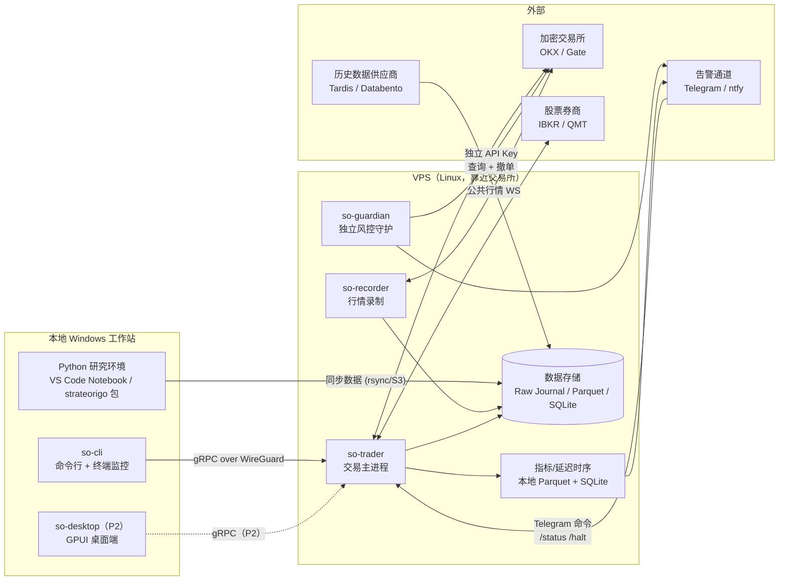
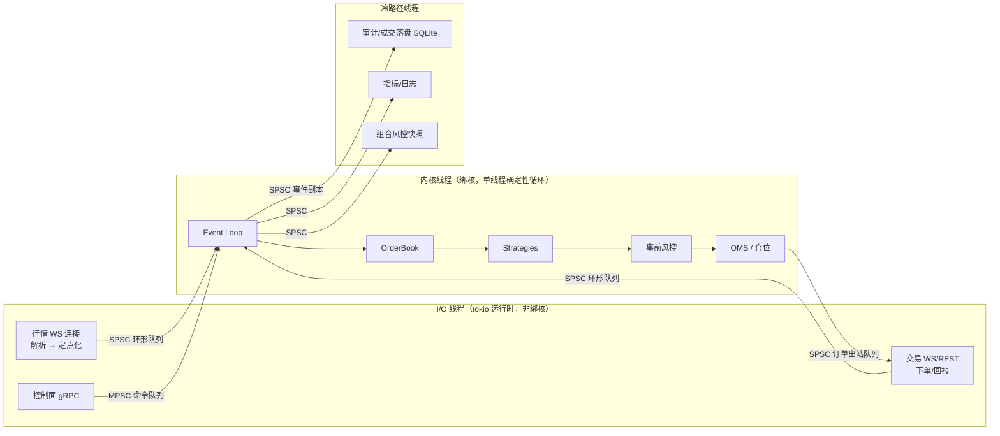
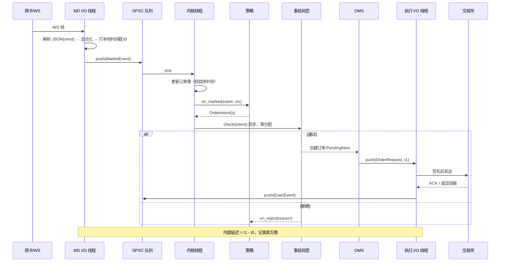
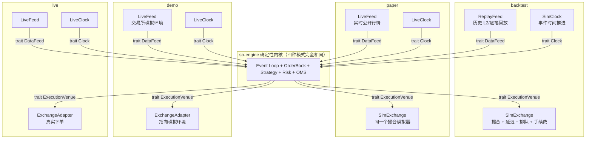
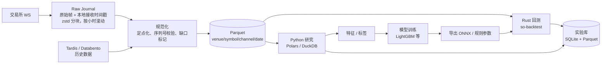
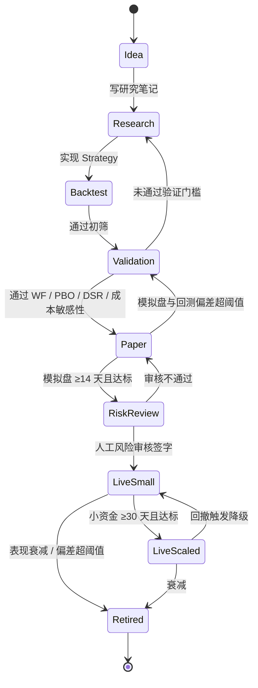
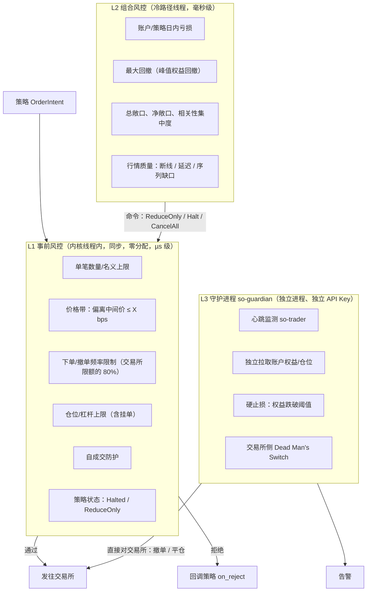

# 01 · 整体架构

## 1. 目标与范围

### 1.1 目标
1. 一个可在 VPS 上 7×24 稳定运行的**自动交易服务**，支持多交易所、多品种；实盘每个实例一个账户一个策略，多策略并行验证在模拟盘中完成。
2. 一个可复现的**研究流水线**：数据 → 特征 → 策略 → 回测 → 优化 → 过拟合检测 → 统计验证 → 模拟盘 → 实盘 → 监控 → 淘汰。
3. **回测与实盘行为一致**：同一份策略代码、同一个事件内核，只替换外部端口。
4. **独立风控**：资金、仓位、杠杆、回撤的硬约束不依赖策略代码的正确性。
5. 完全通过命令行（`so-cli`）、终端监控界面和 Telegram 操作与监控；GPUI 桌面端为 P2，实盘稳定后再做。

### 1.2 非目标（明确不做 / 暂不做）
- ❌ 内置 AI 研究助手（开发阶段使用外部 Agent 即可）。
- ❌ 微秒级以下的"真·HFT"（FPGA、内核旁路、交易所托管机房）。个人 VPS 现实目标见 §6。
- ❌ 股票高频交易（监管与接入限制，见 [04](04-dev-constraints.md#7-合规与市场限制)）。
- ❌ 动态库插件（Rust ABI 不稳定）。插件 = 编译期注册的 crate。
- ❌ 多用户 SaaS、资金托管。本系统只服务单一所有者。
- ❌ **任何 Web 页面**：Web 控制台、Grafana/Prometheus 看板、MLflow UI、浏览器版 Jupyter、HTML 报告，均不使用。

### 1.3 市场与频率分级

| 延迟等级 | 典型持仓 | 适用市场 | 策略语言 | 回测保真度 |
|---|---|---|---|---|
| **HF**（高频） | 毫秒 ~ 秒 | 加密货币 | 仅 Rust | L2（订单簿 + 延迟 + 排队） |
| **MF**（中频） | 秒 ~ 小时 | 加密货币、美股 | Rust，或 Python（≥100ms 决策周期） | L1（逐笔/Bar 事件驱动） |
| **LF**（低频） | 天 ~ 周 | 加密货币、美股、A 股 | Rust / Python | L1 |

## 2. 系统上下文



## 3. 进程拓扑

| 进程 | 运行位置 | 职责 | 失败时影响 |
|---|---|---|---|
| `so-trader`（实盘实例） | VPS | 行情接入、订单簿、策略、事前风控、组合风控、OMS、执行、控制面 API、审计落盘。**一个实例 = 一个真实账户 + 一个策略**（见 §3.2） | 该策略停止；守护进程接管撤单/平仓 |
| `so-trader`（模拟盘实例） | VPS 或本地 | 同一程序以 `paper` 模式运行：多个虚拟账户 + 多个策略，用于验证；**不加载任何 API Key** | 仅影响验证，不影响实盘 |
| `so-guardian` | VPS（另起进程，可另在第二台机器部署心跳监控） | 独立查询**真实**账户、心跳监测实盘实例、触发熔断（撤单/平仓）、告警；不监控模拟盘 | 失去兜底，实盘实例进入 reduce-only 并告警 |
| `so-recorder` | VPS | 独立订阅公共行情，写原始日志与 Parquet | 研究数据缺口，不影响交易 |
| `so-cli` | 本地 / VPS | **主要操作入口**：数据下载/清洗、回测、实验查询、部署、`watch` 终端实时监控、Kill Switch | 无 |
| `so-desktop`（P2） | 本地 | 图形化监控与管理 | 无交易影响 |
| Python 研究 | 本地 | 研究、优化、验证，调用 `so-py` 绑定 | 无 |

> **设计要点**：行情接入与执行适配器放在 `so-trader` **进程内**（减少一次 IPC 跳转），但运行在与策略内核不同的线程上；`so-recorder` 独立订阅，避免录制 I/O 干扰交易。

### 3.1 服务端无头、客户端分离

- **服务端完全无头**：`so-trader`、`so-guardian`、`so-recorder` 运行在没有图形界面的 Linux VPS 上，由 systemd 管理，不依赖任何 GUI 库，也不监听任何 HTTP / Web 端口。
- **客户端是独立程序**：`so-cli`（现在）和 `so-desktop`（P2）都只通过 gRPC 控制面（经 WireGuard/Tailscale）与服务端通信，不包含任何交易逻辑，不持有交易所 API Key。
- **客户端可随时关闭**：客户端断开、崩溃或从未打开，都不影响交易；所有自动化（策略运行、风控、告警、日报）都在服务端完成。
- **编译隔离**：服务端二进制的依赖树中不得出现 GUI crate（CI 用 `cargo tree` 检查）。

### 3.2 进程、账户与策略的对应关系（ADR-0001 已决策）

| 运行模式 | 账户 | 每个进程的账户数 | 每个账户的策略数 |
|---|---|---|---|
| 回测 `backtest` | 虚拟账户 | 不限 | **1** |
| 本地模拟盘 `paper` | 虚拟账户 | 不限 | **1** |
| 交易所模拟盘 `demo` | 交易所模拟环境账户 | 1（跨所策略每个交易所各 1） | **1** |
| 实盘 `live` | 真实账户 | **1**（跨所策略每个交易所各 1） | **1** |

- **实盘始终是"一个进程 = 一个真实账户 = 一个策略"**，启动时强制校验，配置中出现多个策略或多余账户即拒绝启动。
- 多账户、多策略并行**只用于测试验证**，在本地模拟盘中通过多个虚拟账户实现，不占用真实账户。
- 将来如需第二个实盘策略：开一个交易所子账户，再启动一个实盘实例；两者互不影响，可独立部署、暂停、退出。
- 决策细节见 [decisions/0001-strategy-process-model.md](decisions/0001-strategy-process-model.md)。

## 4. `so-trader` 内部线程模型



- **内核线程**是唯一修改交易状态（订单簿、订单、仓位）的地方。单线程意味着无锁、可确定性重放。
- 模拟盘进程中有多个虚拟账户 + 策略时，可以开**多个内核分片**（每个分片一个线程，负责一组账户）；所有分片共用一份行情。实盘进程只有一个账户和一个策略，通常一个内核线程即可。
- I/O 线程只做"收包 → 解析 → 定点化 → 入队"和"出队 → 签名 → 发包"，不含业务逻辑。

## 5. 热路径时序



## 6. 性能目标（个人 VPS 现实目标）

| 指标 | 目标 | 说明 |
|---|---|---|
| 内部 Tick-to-Trade p50 / p99 | ≤ 10µs / ≤ 50µs | 不含网络；VPS 有噪声邻居，p99.9 不承诺 |
| 网络 RTT（VPS ↔ 撮合） | 1~3 ms 级 | 取决于机房选址，**必须实测** |
| 回测吞吐（L2 事件） | ≥ 2M 事件/秒/核 | 用于大规模参数扫描 |
| 行情录制缺口率 | < 0.01% 时间 | 断线自动重连 + 快照重建 |
| 进程崩溃 → 守护进程撤单 | ≤ 3 s | 心跳超时 + 交易所侧 Dead Man's Switch |

> 现实判断：个人在加密货币上的高频优势来自**策略逻辑和成本结构**（Maker 返佣、资金费率、跨所价差、盘口失衡），而不是比专业做市商更快。架构上做到不拖后腿即可。

## 7. 运行模式与一致性设计

### 7.1 四种运行模式

| 模式 | 行情 | 撮合 | 需要 API Key | 用途 |
|---|---|---|---|---|
| `backtest` 回测 | 历史数据回放 | 本地撮合模拟器 | 否 | 研究、优化、验证 |
| `paper` 本地模拟盘 | 真实实时公开行情 | 本地撮合模拟器（与回测同一套） | **否** | **验证策略**：盈亏、成交率、与回测的一致性；支持任意多个虚拟账户并行 |
| `demo` 交易所模拟盘 | 交易所模拟环境 | 交易所模拟环境的真实撮合 | 是（模拟环境 Key） | **验证交易流程**：签名、下单、撤单、回报、对账、断线恢复（OKX 模拟交易 / Gate 测试网，以官方文档为准） |
| `live` 实盘 | 真实实时行情 | 交易所真实撮合 | 是 | 实盘交易 |



**三个端口 trait：`DataFeed`、`Clock`、`ExecutionVenue`。** 内核代码中不允许出现任何"如果是回测则……"的分支。模式只由配置 `mode = "backtest" | "paper" | "demo" | "live"` 决定。

**本地模拟盘的已知局限**：每个虚拟账户都按"市场上只有自己"模拟成交，同一品种上的多个模拟账户不会互相争夺排队位置。因此同一品种的多个模拟结果不能相加当作可实现的合计规模。

### 7.2 多模式同时运行

实盘与模拟盘是独立进程，可以同时运行：

```text
VPS
├─ so-trader --config configs/env/live-okx-funding.toml   # live：1 个真实账户 + 1 个策略
├─ so-trader --config configs/env/paper-lab.toml          # paper：N 个虚拟账户 + N 个策略
├─ so-recorder
└─ so-guardian                                            # 只监控 live
```

两种推荐用法：
- **影子盘**：实盘运行的策略，同时在模拟盘以相同参数运行。实时对比"真实成交"与"模拟器预测的成交"，用差异校准撮合模拟器的排队模型和延迟模型。
- **新旧版本并行**：实盘运行 v1，模拟盘运行 v2；v2 在同样市场环境下稳定更优，再走验证与审核流程替换 v1。

同时运行的安全规则：

| 规则 | 说明 |
|---|---|
| 模拟盘不加载密钥 | `paper` / `backtest` 模式下系统拒绝读取任何密钥文件，物理上不可能真实下单 |
| 资源优先给实盘 | 实盘绑定固定核心、高优先级；模拟盘使用其他核心、低优先级（`nice`）。VPS 规格不足时，模拟盘放到同地区另一台 VPS |
| 数据完全分开 | 状态、数据库、日志按实例分目录；所有记录带 `mode` 字段 |
| 显示与告警区分 | Telegram 消息带 `[LIVE]` / `[PAPER]` / `[DEMO]` 前缀（录制器用 `[REC]`；**前缀集合是封闭的**，见 [04 S10](04-dev-constraints.md)）；`so-cli watch` 中实盘与模拟盘使用不同颜色与标题 |
| 控制命令必须指定目标 | Kill Switch、暂停、退出等命令必须显式指定实例；对 `live` 实例的命令需二次确认 |
| 行情连接数 | 多个进程都订阅公开行情会占用同一 IP 的连接配额；数量多时改为从本机共享行情分发进程读取（第二阶段） |

### 7.3 一致性验证

一致性验证（M5 模拟盘验收要求）：
1. 模拟盘运行期间同步录制行情；
2. 用录制数据跑回测；
3. 比较两者的订单序列、成交、PnL，偏差须在阈值内（见 [05](05-roadmap.md)）。
4. 实盘阶段同理：实盘成交 vs 同期回放回测（以及影子盘），偏差持续超阈值 ⇒ 策略自动降级。

## 8. 数据流水线



- **Raw Journal 是事实来源**。Parquet 可随时从 Raw Journal 重新生成（规范化逻辑升级后重跑）。
- 每个数据集有内容哈希（数据版本号），实验记录必须引用该哈希。
- 采集、清洗规则与数据源细节见 [06-data.md](06-data.md)。

## 9. 策略生命周期



每次状态迁移都写入策略注册表（谁、何时、依据哪个实验 ID）。具体门槛见 [03-module-design.md](03-module-design.md) §9.3；人工风险审核清单见 [07-strategies.md](07-strategies.md) §9。

**研究环境与实盘环境严格分离**：两边共享策略代码、指标算法、配置规范和数据格式，但运行在不同机器上（研究在本地，实盘在 VPS）；回测、优化、模型训练永远不在实盘 VPS 上运行，不占用交易的关键资源。

## 10. 风控分层



**原则**：L3 的阈值比 L2 宽，L2 比 L1 宽；正常情况下永远是 L1 先拦住。L3 动作即事故，必须写复盘。

## 11. 部署拓扑

- **地域**：VPS 选在目标交易所撮合引擎所在云区域（业内普遍认为 OKX 在阿里云香港；Gate 的部署区域需自行测定）。**以实测 RTT 为准**：在香港、东京、新加坡候选区域各开一台 VPS，用 ping 和 WS 时间戳差测量 **1 天**后决定（2026-11-10 调整，原 3 天）。OKX 与 Gate 若不在同一区域，跨所策略选两地 RTT 之和最小的位置。
- **一个交易所组一台 VPS**；跨所策略选两地 RTT 之和最小的位置。
- **实例管理**：每个实例一份配置 `configs/env/<instance>.toml`，用 systemd 模板单元 `so-trader@<instance>.service` 启动；实盘实例与模拟盘实例的单元分开命名（如 `so-trader@live-okx-funding`、`so-trader@paper-lab`）。
- **操作系统**：Ubuntu Server LTS；`systemd` 管理进程；时间同步 `chrony`。
- **网络**：控制面只监听 WireGuard/Tailscale 接口，公网只开 SSH（密钥登录，禁用密码）。
- **数据回传**：Raw Journal 每小时滚动后 `rsync`/对象存储同步回本地研究机。
