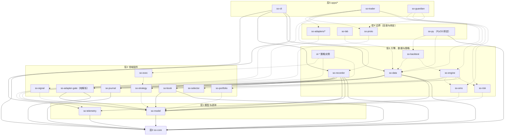
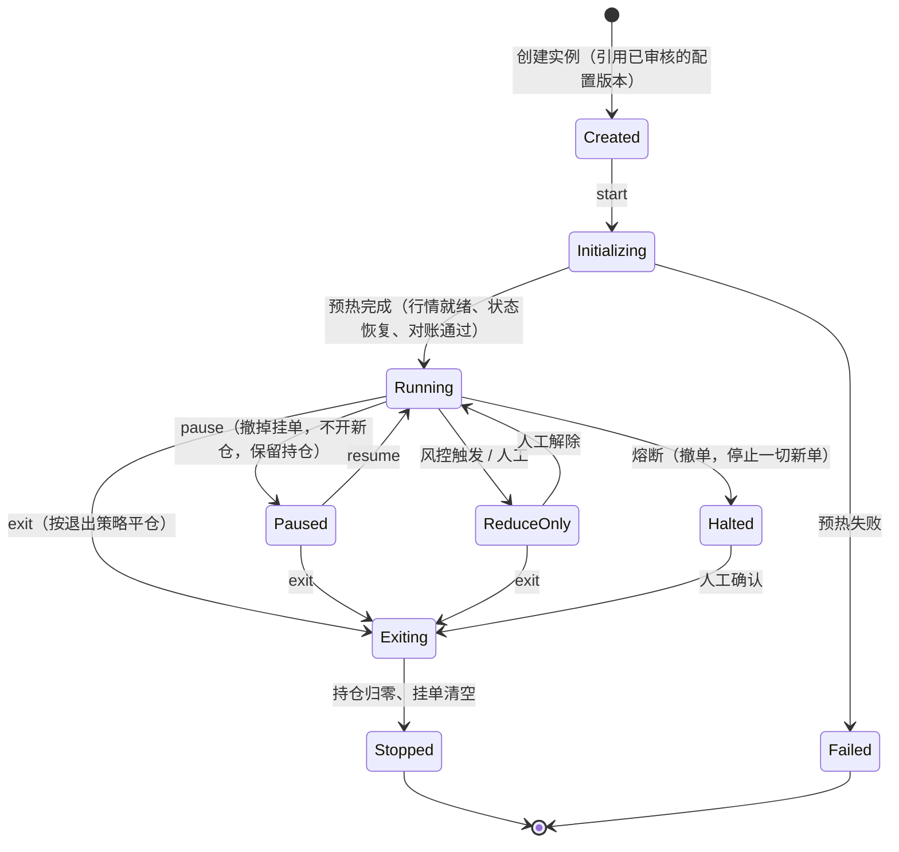
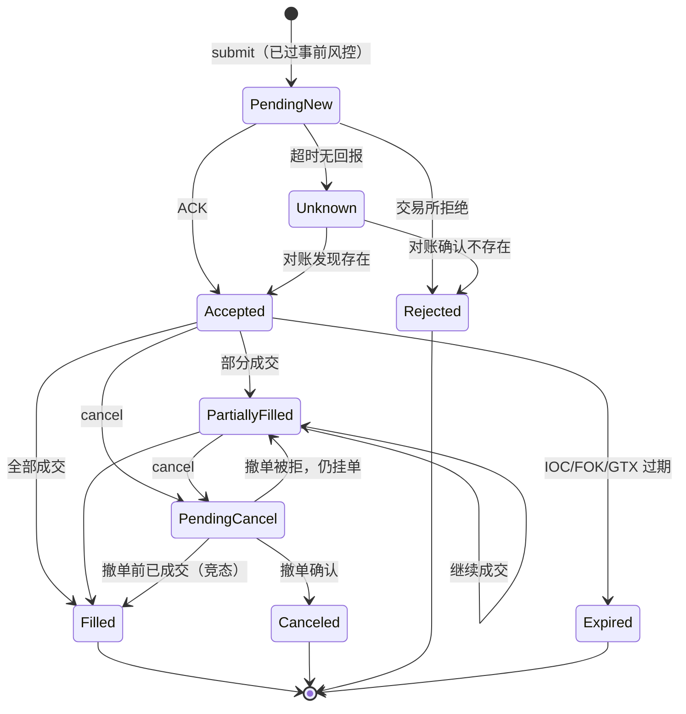
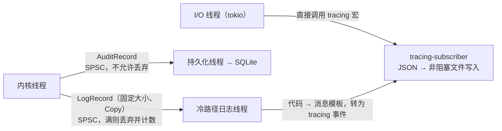

# 03 · 模块设计

## 1. 仓库结构

> `层0`–`层5` 是 **crate 依赖层级**，规则见 [04 §3.5](04-dev-constraints.md)。
> 它们与各领域内部的级别编号无关；领域级别一律带领域前缀（`RK-L*` 风控、`BK-L*` 订单簿、
> `BT-L*` 回测保真度），见 [ADR-0017](decisions/ADR-0017-rule-id-disambiguation.md)。
>
> **本树是"目标结构"，逐行标注【已建】/【规划】**——不标注时读者无法分辨哪一行今天真的存在。
> 层级登记的唯一事实来源是 [04 §3.5](04-dev-constraints.md) 的表（同样逐行标状态），
> `scripts/check-deps.ps1` 直接解析它，**不另存一份期望表**；本树只管"文件放哪"。
> 未建 crate 的层级**先登记**：建成前不在 `cargo metadata` 里，建成当天自动开始机检，
> 不必回头补登记——漏登记在建成时会立刻失败，不会静默漂移。

```text
StrateOrigo/
├─ Cargo.toml                  # 核心 workspace（不含桌面端）
├─ Cargo.lock
├─ rust-toolchain.toml         # channel = "stable"；版本由 Cargo.toml rust-version 固定
├─ deny.toml                   # cargo-deny 规则
├─ CLAUDE.md                   # Agent 协作规则（入口）
├─ crates/
│  ├─ so-core/                 # 【已建】层0 基础类型：UnixNanos、Price、Qty、ID、枚举、错误、Clock trait
│  ├─ so-model/                # 【已建】层1 领域模型：Instrument、Order、Fill、Position、Account、Event
│  ├─ so-telemetry/            # 【已建】层1 tracing/metrics/延迟直方图
│  ├─ so-adapter-gate/         # 【已建】层2 Gate 纯解析适配器（热路径、无网络；连接层在 so-recorder）
│  ├─ so-journal/              # 【已建】层2 Raw Journal 帧格式、读写、sha256 校验、A/B 去重（ADR-0016）
│  ├─ so-book/                 # 【已建】层2 订单簿（BK-L1/BK-L2 深度视图，数组实现，零分配）
│  ├─ so-recorder/             # 【已建】层3 行情录制（WS/REST 采集、Journal 写入、静默检测、告警）；库 + 二进制
│  ├─ so-data/                 # 【已建】层3 规范化、Parquet 读写、数据校验、数据集哈希
│  ├─ so-py/                   # 【已建】层4 PyO3 绑定 → Python 包 strateorigo._core
│  ├─ so-strategy/             # 【规划】层2 Strategy trait、Ctx、OrderIntent、决策管线组件 trait、编译期注册表
│  ├─ so-signal/               # 【规划】层2 可复用的在线特征 / 信号计算（与 Python 特征库逐值对齐）
│  ├─ so-exec/                 # 【规划】层2 执行算法：Maker 挂单管理、TWAP、冰山、跨所对冲腿
│  ├─ so-portfolio/            # 【规划】层2 组合管理：资金分配、目标仓位合并、敞口与相关性
│  ├─ so-selector/             # 【规划】层2 选品器：三种标的形态（单标的/固定池/自主选品，ADR-0018）
│  ├─ so-risk/                 # 【规划】层3 风控：事前（引擎内同步）+ 组合（引擎内实时）
│  ├─ so-oms/                  # 【规划】层3 订单状态机、账户与持仓、对账
│  ├─ so-engine/               # 【规划】层3 确定性事件循环内核（三种模式共用）
│  ├─ so-backtest/             # 【规划】层3 ReplayFeed、SimClock、SimExchange（撮合/延迟/排队/费用）
│  ├─ so-lab/                  # 【规划】层4 本地研究域只读访问：实验库、数据集、报告（so-cli / 桌面端用）
│  ├─ so-adapters/             # 【规划】层4 交易所接入（trait 定义在 so-strategy / so-model，实现在各 adapter）
│  │  ├─ so-adapter-okx/       #      现货 + 永续 SWAP（后置：Gate 优先，见 pending-items #3）
│  │  └─ so-adapter-ibkr/      #  （Gate 的连接层在 so-recorder，纯解析在层2 的 so-adapter-gate）
│  ├─ so-proto/                # 【规划】层4 控制面 protobuf/gRPC（桌面端共用）
│  └─ strategies/
│     ├─ st-mm-basic/          # 【规划】层3 示例：基础做市（M3 回测内核验收用）
│     └─ st-*/                 # 【规划】层3 其余策略实例（依赖层2 的 so-strategy/so-signal/so-exec）
├─ apps/
│  ├─ so-cli/                  # 【已建】层5 主要操作入口：数据、回测、实验、部署、watch、Kill Switch
│  ├─ so-trader/               # 【规划】层5 实盘/模拟盘主进程（M4+）
│  ├─ so-guardian/             # 【规划】层5 独立风控守护进程（M4+）
│  └─ so-desktop/              # P2，暂不创建（将来为独立 workspace，GPUI）
├─ python/
│  ├─ pyproject.toml           # maturin 构建，包名 strateorigo
│  ├─ uv.lock
│  ├─ src/strateorigo/         # src 布局（不是 python/strateorigo/）
│  │  ├─ __init__.py           # 【已建】包入口（当前只有它 + py.typed + 编译出的 _core.pyd）
│  │  ├─ data/                 # 【规划】数据加载、对齐
│  │  ├─ features/             # 【规划】特征库
│  │  ├─ backtest/             # 【规划】封装 Rust 回测（经 so-py）
│  │  ├─ optimize/             # 【规划】Optuna 封装、Walk-Forward 调度
│  │  ├─ validation/           # 【规划】PBO/CSCV、DSR、SPA、Bootstrap、成本敏感性
│  │  ├─ report/               # 【规划】回测/验证报告（Markdown + PNG）
│  │  └─ registry/             # 【规划】实验库（SQLite + Parquet）、策略注册表、生命周期
│  └─ tests/
├─ research/                   # Notebook（不进生产路径）；当前为空，M3 起
├─ proto/                      # .proto 源文件；当前为空，M5 起
├─ configs/
│  ├─ recording.toml           # 录制面品种表（宽；交易面是其子集，ADR-0018）
│  ├─ instruments/             # 品种元数据快照
│  ├─ strategies/              # 策略实例配置（TOML）
│  ├─ risk/                    # 风控限额（TOML）
│  └─ env/                     # dev / paper / live 环境配置（不含密钥）
├─ deploy/                     # systemd unit、Ansible、VPS 初始化脚本
├─ scripts/                    # check.ps1（一键检查）、check-deps.ps1（依赖分层机检，解析 04 §3.5）、sync-journal.ps1、vps-preflight.sh
├─ data/                       # ⚠ .gitignore：本地数据
└─ docs/
```

**依赖图**：实线 = 今天真实存在的边（`cargo metadata`，22 条，机检 0 违规）；
虚线 = 规划边（对应 crate 未建，**不参与机检**）。同层边一律在 [04 §3.5 例外表](04-dev-constraints.md) 登记。



- `so-engine` **不依赖** `so-adapters`、`tokio`、任何网络库（A3；`check-deps.ps1` 检查 4b 机检，
  `so-engine` 未建时跳过）。
- 策略 crate（`st-*`）**只能依赖** `so-strategy`、`so-signal`、`so-exec`（及其重新导出的类型），
  不能直接依赖 OMS、适配器（A3）。它们在**层3**（依赖层2）。
- `so-data → so-recorder` 这条同层依赖已由下沉 `so-journal` 消除（[ADR-0016](decisions/ADR-0016-journal-crate-extraction.md)）；`so-recorder` 与 `so-data` 都只依赖 `so-journal`，两者互不依赖。
- `so-adapter-gate` 是**纯解析**适配器（只依赖 `so-core` + `so-model`），因此在层2 而非层4；含连接/下单的适配器才进层4。
- `so-py` 在**层4**（不是层1）：绑定**是边界**，与 `so-proto` 同类。Python 侧要直连
  `so-data` / `so-backtest`（[03 §9.1](#91-python-api-草图)），若绑定在层1 就会变成
  `层1 → 层3` 的方向违规；放层4 则 `层4 → 层3` 合法。
- `so-lab` **不依赖** `so-backtest`：它读实验库与数据集，不需要"跑一遍回测"。
- 规划边里 `so-backtest → so-engine`、`so-backtest → so-data`、`so-exec → so-strategy` 是**同层边**，
  已登记在 04 §3.5 例外表（标 `规划`，两端建成后自动转入正式机检）。


## 2. so-core：基础类型

```rust
/// 纳秒级 UTC 时间戳。所有时间统一用它。
#[derive(Copy, Clone, Debug, PartialEq, Eq, PartialOrd, Ord, Hash)]
pub struct UnixNanos(pub i64);

/// 定点价格：raw * 10^-scale，scale 由 Instrument 决定。
#[derive(Copy, Clone, Debug, PartialEq, Eq, PartialOrd, Ord, Hash)]
pub struct Price(pub i64);

/// 定点数量。
#[derive(Copy, Clone, Debug, PartialEq, Eq, PartialOrd, Ord, Hash)]
pub struct Qty(pub i64);

/// 紧凑整数 ID（启动时由注册表分配），热路径用作数组下标。
pub struct InstrumentId(pub u32);
pub struct StrategyId(pub u16);
pub struct VenueId(pub u8);
/// 账户是一等概念：订单、成交、持仓、资金流水、风控限额都以 (VenueId, AccountId) 区分。
pub struct AccountId(pub u16);
pub enum AccountKind { Live, Demo, Sim }  // 真实 / 交易所模拟环境 / 本地虚拟
pub enum RunMode { Backtest, Paper, Demo, Live }

/// 时钟端口：live / sim 两种实现。
pub trait Clock {
    fn now(&self) -> UnixNanos;
}
```

规则：
- 定点运算溢出检查：debug 构建 panic、release 构建用 `checked_*` 返回错误（见 04）。
- 价格精度、tick size、lot size、最小名义金额来自 `Instrument`，**启动时从交易所拉取并与 `configs/instruments` 快照比对**，不一致则拒绝启动。

## 3. so-model：事件与领域模型

```rust
pub enum Event {
    Market(MarketEvent),
    Exec(ExecEvent),
    Timer(TimerEvent),
    Control(ControlEvent),
}

pub enum MarketEvent {
    BookSnapshot { inst: InstrumentId, ts_exch: UnixNanos, ts_recv: UnixNanos, seq: u64, /* 档位存于预分配缓冲 */ },
    BookDelta    { inst: InstrumentId, ts_exch: UnixNanos, ts_recv: UnixNanos, seq: u64, side: Side, price: Price, qty: Qty },
    Bbo          { inst: InstrumentId, ts_exch: UnixNanos, ts_recv: UnixNanos, bid: Price, bid_qty: Qty, ask: Price, ask_qty: Qty },
    Trade        { inst: InstrumentId, ts_exch: UnixNanos, ts_recv: UnixNanos, price: Price, qty: Qty, aggressor: Side, trade_id: u64 },
    MarkPrice    { inst: InstrumentId, ts_exch: UnixNanos, price: Price },
    Funding      { inst: InstrumentId, ts_exch: UnixNanos, rate_e8: i64, next_ts: UnixNanos },
    FeedStatus   { venue: VenueId, status: FeedStatus }, // Connected / Gap / Stale / Disconnected
}

pub enum ExecEvent {
    Accepted  { coid: ClientOrderId, venue_oid: u64, ts: UnixNanos },
    Rejected  { coid: ClientOrderId, reason: RejectReason, ts: UnixNanos },
    Filled    { coid: ClientOrderId, price: Price, qty: Qty, fee: Fee, liquidity: Liquidity, ts: UnixNanos, last: bool },
    Canceled  { coid: ClientOrderId, ts: UnixNanos },
    Expired   { coid: ClientOrderId, ts: UnixNanos },
    CancelRejected { coid: ClientOrderId, reason: RejectReason, ts: UnixNanos },
}
```

- 每个事件带 **两个时间戳**：`ts_exch`（交易所时间）与 `ts_recv`（本地接收时间）。回测按 `ts_recv`（经延迟模型）推进。
- 执行事件、订单、成交、持仓都带 `AccountId`；行情事件不带（行情是公共的，多个账户共用）。
- `ClientOrderId` = `[策略ID u16][分片 u8][单调序号 u40]` 编码为 u64，再按交易所格式转字符串（长度限制见各所文档）。实盘重启后序号从持久化的高水位继续。

## 4. so-strategy：统一策略接口

```rust
pub trait Strategy: Send {
    /// 元信息：名称、版本（semver）、延迟等级、订阅的品种与频道
    fn meta(&self) -> StrategyMeta;

    fn on_start(&mut self, ctx: &mut Ctx) {}
    fn on_market(&mut self, ev: &MarketEvent, ctx: &mut Ctx);
    fn on_exec(&mut self, ev: &ExecEvent, ctx: &mut Ctx) {}
    fn on_timer(&mut self, ev: &TimerEvent, ctx: &mut Ctx) {}
    fn on_reject(&mut self, coid: ClientOrderId, reason: RiskReject, ctx: &mut Ctx) {}
    fn on_stop(&mut self, ctx: &mut Ctx) {}
}

/// 策略能看到和能做的一切。不提供任何 I/O。
pub struct Ctx<'a> { /* 内核内部引用 */ }
impl Ctx<'_> {
    pub fn now(&self) -> UnixNanos;
    pub fn book(&self, inst: InstrumentId) -> &OrderBook;
    pub fn position(&self, inst: InstrumentId) -> &Position;
    pub fn open_orders(&self, inst: InstrumentId) -> impl Iterator<Item = &Order>;
    pub fn submit(&mut self, intent: OrderIntent) -> ClientOrderId; // 进入事前风控
    pub fn cancel(&mut self, coid: ClientOrderId);
    pub fn cancel_all(&mut self, inst: InstrumentId);
    pub fn set_timer(&mut self, at: UnixNanos, tag: u32);
    pub fn rng(&mut self) -> &mut SeededRng;  // 唯一允许的随机源
    pub fn emit_metric(&mut self, key: MetricKey, value: f64);
}
```

**插件 / 注册机制**：每个策略 crate 用宏注册工厂函数，`so-trader` 和 `so-py` 在编译期把所有策略链接进来。

```rust
so_strategy::register!("mm-basic", MmBasic::from_config);
```

- 策略参数：TOML → `serde` 反序列化成强类型 `Config` 结构体，启动时校验。
- **策略实例指纹** = `策略名 + semver + git commit + 参数哈希`。每笔订单、每条成交、每次实验都带该指纹。
- **Python 策略**（仅 MF/LF）：通过 `so-py` 提供 `PyStrategy` 适配器。回测中在内核线程调用；实盘中运行在**独立的 Python 宿主线程**，通过队列与内核交互，决策周期 ≥100ms，永远不与 HF 策略同一线程。

### 4.1 决策管线（推荐的策略组织方式）

`Strategy` trait 是内核唯一认识的接口；但策略内部建议用以下可组合组件实现，每个组件可以单独测试、单独做过拟合检测、单独替换：

```rust
/// 1. 信号：由行情计算预测值（例如未来 1s 中间价变化，单位 bps）
pub trait Signal { fn update(&mut self, ev: &MarketEvent, ctx: &Ctx) -> Option<Forecast>; }

/// 2. 交易判断：预期收益是否覆盖成本、当前市场状态是否允许交易
pub trait Gate { fn decide(&mut self, f: &Forecast, ctx: &Ctx) -> Decision; } // Trade / Skip(reason)

/// 3. 仓位：目标仓位多大（波动率目标、Kelly 分数、库存上限）
pub trait Sizer { fn target(&mut self, f: &Forecast, ctx: &Ctx) -> TargetPosition; }

/// 4. 执行：如何从当前仓位走到目标仓位（挂单 / 吃单 / 分批）
pub trait ExecPolicy { fn orders(&mut self, target: &TargetPosition, ctx: &mut Ctx); }
```

- 每次决策（包括"不交易"）写入**决策日志**：信号值、预期收益、估计成本、决策与原因。实盘可通过 `Strategy.StreamDecisions` 查看，回测中用于分析"为什么亏"。
- `so-signal` 中的在线特征必须与 Python `strateorigo.features` 的离线计算**逐值对齐**（同一数据上的一致性测试），否则研究结论无法迁移到实盘。
- 详细的交易判断规则见 [07-strategies.md](07-strategies.md) §4。

### 4.2 策略实例生命周期



- **Pause 与 Exit 的区别**：Pause 保留持仓，策略继续接收行情（便于恢复）；Exit 主动平仓后停止。Exit 的平仓方式（挂单逐步平 / 立即吃单平）在策略配置中声明。
- **运行中修改参数**：只允许修改策略声明为"可热更新"的参数；每次修改生成新的实例指纹并写审计日志，且新参数必须在已审核的取值范围内。
- **状态恢复**：策略可选实现 `snapshot()` / `restore()`；进程重启后先从交易所对账得到真实持仓，再恢复策略内部状态。
- **进程划分**（ADR-0001 已决策）：**一个账户只运行一个策略实例**；实盘进程 = 一个真实账户 + 一个策略（跨所策略为每个交易所各一个账户），启动时强制校验；本地模拟盘进程可以有多个虚拟账户，每个虚拟账户一个策略。见 [decisions/0001-strategy-process-model.md](decisions/0001-strategy-process-model.md)。

### 4.3 两条下单路径

| 路径 | 适用 | 流程 |
|---|---|---|
| **直接路径** | HF 策略、单品种策略 | 策略在账户的**风险预算**内直接产生订单意图 → 事前风控 → 执行 |
| **组合路径** | 多品种 / 选币型 MF / LF 策略 | 策略对币种池中各品种输出**目标仓位**（品种、方向、目标敞口、信号强度）→ 组合管理引擎按资金、相关性与整体敞口缩放 → 事前风控 → 执行算法 |

高频策略不经过组合引擎，避免增加延迟。

## 5. so-book：订单簿

- 每个品种预分配固定深度的价格档位数组（如 ±N 个 tick 的环形价格网格，或排序数组 + 二分查找，**两种都实现基准后选择**）。
- 序列号校验按各所规则实现（例如 OKX 深度频道的 `seqId` / `prevSeqId` 衔接 + 校验和；Gate 的增量 `U` / `u` 衔接；**以 `docs/venues/` 中整理的最新官方文档为准**），不连续或校验和失败 ⇒ 标记 `Gap`，发 `FeedStatus::Gap`，触发重新快照；**Gap 期间策略收到状态事件，风控强制 ReduceOnly**。
- 提供：BBO、指定深度累积量、微价格（microprice）、盘口失衡等常用只读视图。

## 6. so-oms：订单状态机



- **Unknown 状态是必须的**：网络超时时不能假设成功或失败。Unknown 订单计入风险敞口（按最坏情况），直到对账确认。
- 仓位**同时维护两份**：基于成交回报的本地仓位、定期从交易所拉取的仓位。偏差 ⇒ 告警 + 该品种 ReduceOnly。
- 重连流程：断线 → 策略收到 `FeedStatus` → 重连 → REST 拉取挂单与仓位 → 对账 → 恢复。
- 成交去重：按 `(venue, trade_id)` 去重，WS 与 REST 回报可能重复。
- 所有状态迁移写审计日志（SQLite，冷路径异步）。
- **数据库记录不是交易所订单的替代品**：本地记录只是镜像，任何不一致以交易所为准，并触发对账。

### 6.1 账户与持仓管理

| 维护项 | 说明 |
|---|---|
| 余额 | 可用、冻结（挂单占用）、总权益，按币种 |
| 持仓 | 数量、方向、持仓均价、标记价、未实现盈亏、已实现盈亏 |
| 保证金 | 已用保证金、维持保证金、**保证金率**、预估强平价 |
| 费用 | 手续费 / 返佣、资金费收支（逐笔记录结算时刻与费率） |
| 资金流水 | 充值、提现、子账户划转、资金费、手续费全部入账，可从流水重算余额 |

- 本地账户状态由成交回报和资金费事件实时更新；**定期（如每 30s）与交易所对账**，偏差超阈值 ⇒ 相关策略进入 ReduceOnly 或 Halted，并告警。
- 账户模式（单币种 / 跨币种保证金、单向 / 双向持仓）按交易所实际设置读取并校验，与配置不符拒绝启动。

## 7. so-risk：风控

**四级规则 × 三个执行位置**：规则按"管什么"分四级，按"在哪里执行"落到三个位置。

| 规则级别 | 内容 | `RK-L1` 事前（内核内，µs） | `RK-L2` 组合（冷路径线程，ms） | `RK-L3` 守护进程（独立进程） |
|---|---|---|---|---|
| **订单级** | 单笔金额/数量、价格偏离、订单频率、自成交 | ● | | |
| **策略级** | 最大仓位、策略回撤、日内亏损、连续亏损、库存上限 | ●（仓位、状态门） | ●（回撤、亏损） | |
| **账户级** | 总敞口、总亏损、杠杆、**保证金率**、账户回撤 | ●（杠杆、总仓位） | ● | ●（硬阈值） |
| **系统级** | 行情异常 / 断线、订单状态异常、对账偏差、进程心跳、Kill Switch | ●（行情新鲜度） | ● | ● |

**任何策略都不能绕过风控**：策略只能通过 `Ctx::submit` 下单，`Ctx` 不暴露执行端；这一点由 crate 依赖规则（§1）在编译期保证。

**`RK-L1` 事前风控**（`fn check(&mut self, intent: &OrderIntent, state: &RiskState) -> Result<(), RiskReject>`）：

| 检查项 | 说明 |
|---|---|
| 单笔数量 / 名义上限 | 按品种、按策略 |
| 价格带 | 限价单偏离中间价 ≤ X bps；市价单要求盘口深度足够 |
| 频率限制 | 令牌桶，按交易所限额的 80% 设置；撤单率单独限制 |
| 仓位上限 | 当前仓位 + 同方向挂单（含 Unknown）不超过上限 |
| 杠杆上限 | 名义敞口 / 权益 |
| 自成交防护 | 使用交易所 STP（如支持）；策略自身的买卖挂单不得交叉 |
| 状态门 | 品种/策略/全局处于 `Halted`、`ReduceOnly` 时拒绝开仓 |
| 行情新鲜度 | 最近行情距今 > 阈值 ⇒ 拒绝新开仓 |

**`RK-L2` 组合风控**（冷路径线程，每 N 毫秒或每笔成交后计算）：日内亏损、最大回撤、总/净敞口、按策略资金预算、相关性集中度、行情质量。触发 ⇒ 下发 `ControlEvent::{ReduceOnly, Halt, CancelAll}`。

**`RK-L3` so-guardian**（独立进程）：
- 独立 API Key（**只开读取 + 交易权限，禁止提现**，绑定 VPS IP 白名单）。
- 每 1s 读 `so-trader` 心跳（本地 Unix socket / 共享内存），超时 3s ⇒ 撤销全部挂单 + 告警；权益跌破硬阈值 ⇒ 平仓 + 告警。
- 同时启用交易所侧 **Dead Man's Switch**（如 OKX 的 cancel-all-after、Gate 的 countdown cancel all；**接入前以各所最新文档为准**），由 `so-trader` 定期续期。
- 风控限额配置文件 `configs/risk/*.toml` 由**人工维护**，修改需要 review，`so-trader` 启动时打印并记录其哈希。

## 8. so-backtest：回测

### 8.1 保真度分级
| 级别 | 实现 | 用途 | 能否作为晋级依据 |
|---|---|---|---|
| `BT-L0` | Python 向量化（Polars/numba/vectorbt） | 想法快速初筛 | ❌ |
| `BT-L1` | Rust 事件驱动，Bar / 逐笔成交撮合 | MF / LF 策略 | ✅（MF/LF） |
| `BT-L2` | Rust 事件驱动，`BK-L2` 订单簿 + 延迟 + 排队 | HF 策略 | ✅（HF 必须） |

### 8.2 SimExchange 模型
- **延迟模型**：行情延迟（交易所 → 本地）、下单延迟（本地 → 交易所）、回报延迟。来源：实盘/模拟盘测得的经验分布（按时段），默认常数 + 抖动。
- **排队模型**：限价单进入某价位时排在队尾；该价位成交量消耗前方队列；撤单按比例模型（例如前方撤单概率与队列位置相关）减少前方队列。提供多种模型（保守 / 比例 / 概率），**默认用保守模型**。
- **撮合**：吃单按当时可见盘口逐档成交（含滑点）；不允许"成交于自己看不到的价格"。
- **费用**：Maker/Taker 费率按 VIP 等级配置；永续资金费按实际资金费率时间点结算；现货借贷利息（如有）。
- **市场冲击**：HF 小单默认忽略；MF 大单可选平方根冲击模型。
- **对照验证**：M3 阶段用 hftbacktest 在相同数据、相同参数下运行同一策略，结果偏差需在可解释范围内。

### 8.3 性能
- 单次回测单线程确定性；参数扫描用进程/线程级并行（rayon，每个任务独立的内核实例）。
- 数据按块（Arrow RecordBatch）流式读取，内存占用与回测区间长度无关。

## 9. 研究与验证（so-py + strateorigo Python 包）

### 9.1 Python API 草图
```python
from strateorigo import data, backtest, validation, optimize

ds = data.load("okx-swap", "BTC-USDT-SWAP", channels=["depth", "trade"],
               start="2026-09-01", end="2026-10-01")          # 返回带 dataset_hash 的句柄
res = backtest.run("mm-basic", params={...}, dataset=ds,
                   latency="empirical:tokyo-2026q3", queue="conservative", seed=42)
res.equity          # pyarrow / polars
res.fills
res.metrics         # Sharpe、Sortino、MaxDD、换手、Maker 占比、单笔期望等

study = optimize.walk_forward("mm-basic", space={...}, dataset=ds,
                              train="14d", test="3d", step="3d", n_trials=200)
report = validation.full_report(study)   # PBO、DSR、SPA、成本敏感性、参数稳定性
```

### 9.2 过拟合检测与统计验证（必须全部实现并有单元测试）
| 方法 | 作用 |
|---|---|
| Walk-Forward（滚动 / 锚定） | 样本外表现 |
| Purged K-Fold + Embargo | 有标签重叠时的交叉验证（ML 策略） |
| CSCV → PBO（回测过拟合概率） | 参数选择的过拟合程度 |
| Deflated Sharpe Ratio | 校正多次试验与非正态收益后的夏普显著性 |
| White Reality Check / Hansen SPA（arch 库） | 多策略比较时的数据窥探偏差 |
| 交易序列 Bootstrap / Monte Carlo | 回撤与收益分布的置信区间 |
| 参数稳定性热力图 | 最优参数邻域是否平坦 |
| 成本敏感性 | 手续费 ×1.5、延迟 ×2 后是否仍盈利 |
| 最小样本量 / 最小交易次数 | 避免小样本结论 |

### 9.3 晋级门槛（初始值，可按经验调整）
| 迁移 | 条件 |
|---|---|
| Backtest → Validation | 样本外 Sharpe > 1.5（HF 按日收益计）、交易数 ≥ 1000（HF） / 200（MF） |
| Validation → Paper | PBO < 0.3；DSR 显著（p < 0.05）；成本敏感性测试仍盈利；参数邻域稳定 |
| Paper → LiveSmall | ≥14 天；模拟盘与同期回放回测 PnL 偏差 < 20%，成交率偏差 < 15% |
| LiveSmall → LiveScaled | ≥30 天；实盘与同期回放回测偏差在阈值内；未触发 `RK-L2` 以上风控 |
| 任何状态 → Retired | 滚动 30 天 Sharpe 低于阈值，或偏差持续超阈值 |

### 9.4 实验追踪（自研实验库，无 Web UI）
每次回测/优化写入实验库（`data/experiments.db` + `data/experiments/<run_id>/*.parquet`）：`dataset_hash`、`git_commit`、`dirty` 标志（有未提交改动时**禁止**记录为正式实验）、策略指纹、参数、种子、延迟/排队模型版本、指标、权益曲线与成交。报告输出为 `report.md` + PNG 图。查询：`so-cli exp list/show/compare` 或 `strateorigo.registry`。

## 10. so-data：数据

> 完整的数据获取与清洗设计见 **[06-data.md](06-data.md)**（§9.1 是实现约定）。本节只列模块边界。
> 逐行标【已建】/【规划】：下面若写成一个今天不存在的模块（如 `so-data::clean`），
> 就是读者最容易误判"已经能用"的地方。

| 模块 | 职责 | 状态 |
|---|---|---|
| `so-journal::writer` | Raw Journal **写入**（JSONL 帧 + zstd 多帧，按小时滚动 + sha256 边车） | 已建 |
| `so-journal::row` / `dedup` | Journal 行模型（`JournalRow`）与 A/B 双流去重键 | 已建 |
| `so-data::journal_in` | Raw Journal **读取**（流式 zstd 解码、尾帧截断容忍、`rest.contracts` 恢复） | 已建 |
| `so-data::contracts` | 合约快照 → 精度与时点 `instrument` 行 | 已建 |
| `so-data::normalize` | 各交易所原始消息 → 统一事件（`so-model::MarketEvent`），定点化 | 已建 |
| `so-data::parquet_out` / `instrument_out` | Parquet 落盘与 schema（分区布局、数据集哈希） | 已建 |
| `so-data::pipeline` | 按日编排：列出 Journal → 读取 → 归并去重 → 规范化 → 落盘 | 已建 |
| `so-data::bookcheck` | C9 订单簿重建验证（REST 快照比对，前 N 档一致率）；2026-11-13 自 so-recorder 归位 | 已建 |
| `so-data::intervals_out` / `rebuild_out` | `quality_intervals` / `quality_rebuild` 区间与验证表落盘 | 已建 |
| `so-data::quality_scan` | 读回 Parquet 产出 `(venue, symbol)` 评级输入（`data check` 算法层） | 已建 |
| `so-data::dataset` / `dataset_out` | 数据集清单模型、文件摘要与哈希（docs/06 §7）、toml 落盘 | 已建 |
| `so-data::error` | 数据域错误枚举与 `code()`（`Data*`） | 已建 |
| `so-data::clean` | 清洗规则引擎（C1–C13，见 06 §5），只加标记不删数据，输出清洗报告 | **规划**（M2 后段） |
| `so-data::store` | 数据集清单与哈希（`data/datasets/<hash>.toml`） | **规划** |
| `so-data::calendar` | 交易日历、交易所维护窗口 | **规划** |

- 读与写共用的**文件格式**在 `so-journal`（层2）：写入端 `so-recorder` 与读取端 `so-data`
  都只依赖它，两个 crate 之间**没有**依赖边（ADR-0016，由 `check-deps.ps1` 机检）。
  `so-recorder` 仍重新导出 `so_journal::{JournalRow, JournalWriter, …}`，供既有调用点沿用。
- 模块内部的分工遵循 [04 §3.4 I8/I9](04-dev-constraints.md)：**编排层不做算法，算法层不做 I/O**。
- **历史数据下载不在本节**：`so-cli data download` 的实现是 `so-recorder` 的
  `download.rs`（Gate REST 拉取、分页、断点续传）+ `download_run.rs`（编排与报告），
  **不是** `so-data` 的模块——下载是"取来原始数据"，与录制同属取数入口。

## 10.1 so-recorder：录制与取数模块

| 模块 | 职责 |
|---|---|
| `so-recorder::run` / `run.rs` | 录制主循环与实例编排 |
| `so-recorder::connection` / `ws` | WS 连接、重连与订阅管理 |
| `so-recorder::frame` | 帧解包与序列号校验（复用 `so-adapter-gate` 的纯解析） |
| `so-recorder::journal` / `dedup` / `hash` | **重新导出** `so-journal` 的类型与函数（`lib.rs` 内的 `pub use` 兼容模块，非独立文件），让既有 `crate::journal::X` 调用点不必改写 |
| `so-recorder::snapshot` / `snapshot_pull` | 定时拉取 REST 快照（可达性校验，06 §3.2 A6） |
| `so-recorder::silence` / `alert` | 静默检测（连接在但不推数据）与告警 |
| `so-recorder::config` / `timefmt` | 录制配置解析与时间格式化 |
| `so-recorder::download` / `download_run` | 官方历史数据下载（Gate REST）与编排 |
| `so-recorder::error` | 录制域错误枚举与 `code()`（`Recorder*`，转发 `Journal*`） |

> `bookcheck`（C9 订单簿重建验证）原在本 crate，2026-11-13 归位
> `so-data::bookcheck`——它是纯离线分析，随清洗链路走（pipeline 在
> normalize 时产出 `quality_rebuild` 表与 C9 区间）；离线工具
> `book-check` 也随迁 `crates/so-data/examples/`。

## 11. 控制面与客户端接口预留（so-proto）

gRPC 服务（tonic），**只监听内网接口**，mTLS 或 Token 认证，所有写操作审计。

**预留原则**：客户端（P2）需要的所有数据和操作，都由服务端接口提供，并在服务端阶段（M5）全部实现，先由 `so-cli` 使用和验证。M9 做 GUI 时**只写界面，不改服务端**。

| 服务 | 方法 | 对应客户端页面 | 首个使用者 |
|---|---|---|---|
| `Monitor` | `StreamPortfolio`、`StreamPositions`、`StreamOrders`、`StreamFills`、`StreamRisk`、`StreamLatency`、`StreamHealth`（连接/行情质量） | 总览、风控 | `so-cli watch` |
| `Market` | `GetBars(venue, symbol, interval, from, to)` / `StreamBars(...)`：K 线（含未收盘的当前 Bar）<br/>`GetTrades` / `StreamTrades`：逐笔<br/>`GetBook` / `StreamBook(depth, throttle_ms)`：盘口<br/>`GetIndicators(bars_ref, spec)`：指标序列（MA、布林、VWAP 等，服务端计算）<br/>`GetChartMarkers(strategy, from, to)`：成交点、开平仓、风控事件，用于叠加到 K 线 | 行情（K 线、盘口、逐笔） | `so-cli market bars/book` |
| `Strategy` | `ListStrategies`、`GetStrategy`（指纹、参数、生命周期状态、晋级记录）、`GetPnlBreakdown`、`GetMarkout`、`StreamDecisions`（决策日志：信号值、预期收益、成本、是否交易及原因） | 策略 | `so-cli strategy` |
| `Control` | `StartStrategy`、`StopStrategy`、`SetReduceOnly`、`CancelAll`、`KillSwitch`（二次确认）、`SetLogLevel`（限时，§18.4） | 策略、风控 | `so-cli trader` / `kill` |
| `Recording` | `GetRecordingStatus`（读取 `so-recorder` 在本机写出的状态文件） | 数据质量 | `so-cli data status` |
| `Query` | `GetOrders(range)`、`GetFills(range)`、`GetAuditLog(range)`、`GetDailyReport(date)`、`GetLogs(filter)` / `StreamLogs(filter)`（运行日志，§18） | 订单成交、日志审计 | `so-cli logs` |
| `Config` | `GetRiskLimits`、`GetStrategyConfig`（**只读**；修改走配置文件 + 部署） | 风控、策略 | `so-cli` |

**两个数据域**：上表是 **VPS 交易域**的接口（实时、实盘相关），由 `so-trader` 提供。**本地研究域**（实验库、数据集、质量报告、验证报告）在本地研究机上，不经过 VPS，由 Rust 库 `so-lab` 以只读方式直接读取本地文件，`so-cli exp/data` 和将来的桌面端都链接这个库：

| `so-lab` 函数 | 对应客户端页面 |
|---|---|
| `list_experiments`、`get_experiment`、`equity_curve`、`validation_report`、`compare` | 回测与实验 |
| `list_datasets`、`quality_report` | 数据质量 |
| `bars(dataset, symbol, interval, range)`、`chart_markers(run_id)` | 回测结果的 K 线回放（与 `Market` 接口返回相同的数据结构） |

**K 线数据接口约定**
- 周期：`1s, 1m, 5m, 15m, 1h, 4h, 1d`；服务端从逐笔成交实时聚合，与研究用的 Bar 生成代码为**同一份实现**。
- 分页：按时间区间 + 最大条数；客户端缩放时按需加载。
- 数据中带质量标记（该 Bar 是否覆盖缺口区间），客户端可显示为灰色。
- 价格以定点整数 + 精度传输，客户端负责格式化。

**通用约定**
- 推送流在服务端**节流与降采样**（盘口默认 ≤ 20 次/秒），客户端不需要逐 tick 数据。
- 所有列表接口支持分页；所有流接口支持断线后从 `last_seq` 续传。
- 消息版本兼容：protobuf 字段只增不删，`reserved` 已删字段；`proto/` 目录即接口文档。
- 接口测试：每个 RPC 都有集成测试（启动 paper 模式 `so-trader` + 客户端调用）。

## 12. 命令行 so-cli（主要操作入口）

| 命令组 | 示例 | 说明 |
|---|---|---|
| `data` | `so-cli data download okx-swap BTC-USDT-SWAP --from 2026-01-01 --channel trades`<br/>`so-cli data normalize --date 2026-11-01`<br/>`so-cli data check --date 2026-11-01`<br/>`so-cli data ls` | 下载、规范化、清洗、质量检查、数据集列表与哈希 |
| `bt` | `so-cli bt run mm-basic -c configs/strategies/mm-basic.toml --dataset <hash>` | 回测，结果写入实验库 |
| `exp` | `so-cli exp list --strategy mm-basic`<br/>`so-cli exp show <run_id>`<br/>`so-cli exp compare <a> <b>` | 查询实验库，终端表格 + 生成 Markdown/PNG 报告 |
| `strategy` | `so-cli strategy promote mm-basic@0.3.1 --to paper --evidence <run_id>` | 生命周期迁移（检查门槛） |
| `trader` | `so-cli trader status`、`start/stop <instance>`、`reduce-only`、`cancel-all` | 经 gRPC 控制 so-trader |
| `watch` | `so-cli watch` | ratatui 终端实时界面：持仓、PnL、挂单、风控使用率、延迟、行情健康度 |
| `logs` | `so-cli logs live-okx-funding --level warn --since 1h --follow` | 查看指定实例的运行日志（§18.6） |
| `kill` | `so-cli kill --confirm` | Kill Switch：撤全部挂单、全部策略 Halt（可选平仓） |

**Telegram**：只做告警推送 + 白名单用户的少量命令（`/status`、`/pnl`、`/halt`、`/reduceonly`）；`/halt` 需二次确认；不提供开仓类命令。

## 13. 桌面端 so-desktop（P2，暂不开发）

实盘稳定（M6 小资金实盘稳定运行 ≥ 3 个月、M8 完成）之后，作为 M9 启动。届时技术选型为 GPUI Kit（见 02 §3），**只消费 §11 已有的接口**，页面规划：

| 页面 | 使用的接口 |
|---|---|
| 总览 | `Monitor.StreamPortfolio / StreamHealth`、`Query.GetDailyReport` |
| 行情（K 线、盘口、逐笔） | `Market.*`（K 线叠加 `GetIndicators`、`GetChartMarkers`） |
| 策略 | `Strategy.*`、`Control.*` |
| 订单与成交 | `Monitor.StreamOrders / StreamFills`、`Query.GetOrders / GetFills` |
| 风控 | `Monitor.StreamRisk`、`Config.GetRiskLimits`、`Control.KillSwitch` |
| 回测与实验 | `so-lab`（本地实验库） |
| 日志审计 | `Query.GetAuditLog` |

## 14. so-portfolio：组合管理

由于"一个账户只运行一个策略"，组合管理分为两层：

**账户内（进程内）**——针对多品种 / 选币型策略：

| 职责 | 说明 |
|---|---|
| 目标仓位缩放 | 按账户资金、各品种波动率与流动性，把策略输出的目标敞口换算成实际仓位 |
| 资金按质量分配 | 各品种的资金占比按其单独验证结果分配，而不是平均分配 |
| 币数上限 | 同时持仓的品种数不超过配置 `max_symbols` |
| 整体敞口 | 计算账户相对 BTC 的总 Beta 敞口与方向集中度；所有仓位同向时按"一个大仓位"控制 |

**跨账户（冷路径）**——当存在多个实盘账户（将来）或多个虚拟账户（模拟盘）时：

| 职责 | 说明 |
|---|---|
| 资金分配 | 每个账户 / 策略的资金规模，按表现与相关性定期调整（人工确认）；实盘通过子账户划转落地 |
| 敞口与相关性 | `so-guardian` 汇总所有实盘账户的总敞口、净敞口与策略收益相关性 |
| 组合报告 | 日报中给出组合层面的收益、回撤与各策略贡献 |

- 策略赚钱不等于组合赚钱：多个策略可能同时暴露于同一种市场风险。

## 15. 交易所接入层（so-adapters）

统一接口按"能力"拆分，而不是一个大接口；策略与内核只依赖 trait，不依赖具体交易所。

```rust
pub trait MarketDataGateway {          // 行情：订阅、快照、重连、缺口恢复
    fn subscribe(&mut self, subs: &[Subscription]) -> Result<()>;
    fn snapshot(&mut self, inst: InstrumentId) -> Result<BookSnapshot>;
}
pub trait TradingGateway {             // 交易：下单、撤单、改单、批量
    fn place(&mut self, req: &OrderRequest) -> Result<()>;
    fn cancel(&mut self, req: &CancelRequest) -> Result<()>;
    fn amend(&mut self, req: &AmendRequest) -> Result<()>;      // 需 capabilities.amend
    fn cancel_all_after(&mut self, timeout_ms: u32) -> Result<()>; // Dead Man's Switch
}
pub trait AccountGateway {             // 账户：余额、持仓、挂单、成交、资金流水（对账用）
    fn balances(&mut self) -> Result<Vec<Balance>>;
    fn positions(&mut self) -> Result<Vec<PositionSnapshot>>;
    fn open_orders(&mut self) -> Result<Vec<OrderSnapshot>>;
    fn fills_since(&mut self, ts: UnixNanos) -> Result<Vec<FillSnapshot>>;
}

pub struct VenueCapabilities {         // 启动时加载，策略与执行算法据此选择行为
    pub inst_types: InstTypeSet,       // Spot / Perpetual / Delivery / Option
    pub post_only: bool, pub ioc: bool, pub fok: bool,
    pub amend: bool, pub batch_place: u16, pub batch_cancel: u16,
    pub ws_trading: bool,              // 是否支持 WS 下单
    pub cancel_all_after: bool,
    pub position_mode: PositionModes,  // 单向 / 双向
    pub client_oid_rule: ClientOidRule,// 长度、字符集、前缀要求
    pub rate_limits: RateLimitTable,
}
```

- 每个适配器负责：签名鉴权、限频（令牌桶，按交易所规则分桶）、超时与重试（**下单不自动重试**，超时进入 Unknown 后走对账）、心跳、断线重连、幂等（`clientOrderId` 去重）。
- 不假设各交易所行为一致：差异写在 `docs/venues/<venue>.md` 与 `VenueCapabilities` 中，执行算法遇到不支持的能力时降级（例如不支持改单 ⇒ 撤单再下单）。

## 16. 定时任务调度

由 `so-trader`（交易相关）与本地 `so-cli`（研究相关）分别承担，任务定义在 `configs/schedule.toml`，执行结果写审计日志并在失败时告警。

| 任务 | 位置 | 频率 |
|---|---|---|
| 账户 / 持仓 / 挂单对账 | VPS | 每 30s + 每次重连 |
| Dead Man's Switch 续期 | VPS | 每 N 秒 |
| 品种元数据刷新与比对 | VPS | 每小时 |
| 资金费结算核对 | VPS | 每个结算时刻后 |
| 每日策略日报、组合日报 | VPS | 每日 UTC 00:05 |
| Raw Journal 滚动与同步 | VPS → 本地 | 每小时 |
| 数据规范化 / 清洗 / 质量报告 | 本地 | 每日 |
| 实盘 vs 回放回测一致性比对 | 本地 | 每日 |
| 子账户资金划转 | VPS | 每日检查，人工确认 |

## 17. 实盘输入记录与重放

内核是确定性的，因此**记录实盘进程的全部输入即可完整复现实盘**：

- `so-trader` 把进入内核的每个事件（行情、成交回报、定时器、控制命令、配置变更）按处理顺序写入**输入日志**（与 Raw Journal 同格式，冷路径异步写）。
- `so-cli replay <instance> --date 2026-11-08` 在本地用同一版本代码重放，得到与实盘逐笔一致的信号、决策、订单序列。
- 用途：事故复盘、"为什么下了这一单"、验证修复是否正确（修复后重放应在问题点产生不同决策）。
- 重放与实盘不一致本身就是 bug（非确定性来源），必须修复。
- 全流程追踪链：行情 → 信号 → 决策 → 订单意图 → 风控结果 → 订单 → 成交 → 持仓 → 资金，每一环都带实例指纹与关联 ID（`event_seq`、`decision_id`、`coid`），可双向追溯。

## 18. 日志与可观测性（so-telemetry）

### 18.1 六类记录，各管各的

| 类别 | 内容 | 格式与位置 | 能否丢失 | 保留 | 用途 |
|---|---|---|---|---|---|
| **运行日志** | 启动、连接/重连、序列缺口、限频、错误、警告 | JSON Lines，`data/<instance>/logs/`，按天滚动 | 可丢（丢弃计数） | 90 天 | 排障 |
| **审计日志** | 订单、成交、控制命令、配置变更、生命周期迁移、风控动作 | SQLite（WAL） | **不可丢** | 永久 + 异地备份 | 追责、对账 |
| **决策日志** | 每次决策（含"不交易"）：信号值、预期收益、成本、原因 | Parquet，按天 | 不可丢 | 实盘永久；模拟盘 1 年 | 策略分析 |
| **输入日志** | 进入内核的全部事件（§17） | Raw Journal 格式 | 不可丢 | 实盘 ≥ 1 年 | 精确重放 |
| **指标与延迟** | 计数器、延迟直方图、队列深度 | 本地 Parquet/SQLite 时序（02 §2.5） | 可降采样 | 1 年 | 性能监控 |
| **告警** | 代码显式发出的告警事件 | Telegram + SQLite 记录 | 不可丢（发送失败重试） | 永久 | 通知人 |

- **运行日志不是事实来源**：订单、成交、持仓以审计库和交易所为准，不从运行日志恢复状态，也不从运行日志统计交易数据。
- **告警不靠扫描日志**：告警由代码显式发出（`Alert` 事件，带级别与去重键）；ERROR 日志本身不推送 Telegram，避免告警风暴。ERROR 速率作为指标监控，超阈值再告警。

### 18.2 热路径怎么记日志



- 内核线程**不调用** `tracing::info!` 等宏（04 H9）。改为写入 `LogRecord { ts: UnixNanos, level: u8, code: LogCode, args: [i64; 4] }`：错误码是枚举，参数是整数（定点价格、ID），不含字符串，不分配内存。
- 运行日志队列满时**丢弃**，并递增 `log_dropped_total` 指标，内核永不阻塞。
- 审计队列**不允许丢弃**：容量按峰值订单速率的 100 倍配置；一旦写满，内核进入 ReduceOnly 并告警（没有审计记录就不能继续开仓）。
- I/O 线程和冷路径线程可以直接使用 `tracing` 宏。

### 18.3 格式与字段

- **VPS 上一律 JSON Lines**，便于 `jq` 和程序过滤；本地 `so-cli` 输出人类可读的彩色文本。
- 每条记录的固定字段（顺序固定，事件字段不得覆盖；撞名时自动加 `field.` 前缀）：`ts`（UTC，纳秒，RFC 3339）、`level`、`instance`、`mode`、`venue`、`account`、`strategy`、`target`（模块路径）、`msg`；有关联时附带 `event_seq` / `decision_id` / `coid`，可以和审计库、决策日志对上。
- **事件字段命名规则**见 [04 §3.6 G5](04-dev-constraints.md)：`snake_case`，时间带 `_ts` 后缀且单位写进名字，错误码字段固定叫 `code`，异常详情固定叫 `error`。**记录错误必须带 `code`**（04 G4）。
- 时间：一律 UTC 墙钟时间；回测中另加 `sim_ts`（模拟时间）。

### 18.4 级别约定

| 级别 | 用于 | 示例 |
|---|---|---|
| ERROR | 需要人工处理 | 对账不一致无法自动修复、订单进入 Unknown 超时、配置校验失败 |
| WARN | 异常但已自动处理 | 断线重连、序列缺口后重建订单簿、接近限频、数据延迟 |
| INFO | 状态变化 | 启动/停止、连接建立、生命周期迁移、参数热更新、每分钟摘要 |
| DEBUG / TRACE | 开发调试 | 逐条消息、逐个决策细节 |

- 实盘默认 `INFO`，**不按 tick 打 INFO 日志**；同一条 WARN 按键限流（如每 10 秒最多一次，附"已抑制 N 次"）。
- 运行时调级：`Control.SetLogLevel(instance, filter, ttl)`，到期自动恢复；调级本身写审计日志。
- 回测默认 `WARN`，避免 I/O 拖慢回测；日志输出不影响回测结果（确定性）；每次回测的日志存入该实验的目录。

### 18.5 安全

- 日志中绝不出现：API Key、Secret、Passphrase、签名、签名前的请求串、完整请求头（04 S2）。
- 适配器的请求/响应日志只记录端点、状态码、耗时和业务字段。
- 启动时打印的生效配置先脱敏再输出。
- CI 测试：在故障注入测试的日志输出中搜索密钥模式，命中即失败。

### 18.6 文件管理与查看

- 按天滚动（`tracing-appender`）；超过 1 天的文件由定时任务（§16）压缩为 zstd，超过 90 天删除；日志目录设总量上限，磁盘可用空间低于阈值时告警。
- systemd：stdout/stderr 只用于日志系统初始化之前的启动错误，由 journald 捕获。
- 查看：`so-cli logs <instance> --level warn --since 1h [--grep 文本] [--follow]`，经 gRPC `Query.GetLogs` / `Query.StreamLogs`（将来的桌面端日志页面复用）；在 VPS 上也可直接 `jq` 查询文件。

### 18.7 Python 侧

- 研究代码用标准库 `logging`，自写 JSON 格式化器，字段名与 Rust 侧一致；不引入额外日志库。
- `so-py` 中 Rust 的日志通过 `pyo3-log` 转给 Python `logging`（M3 验证可行性；不可行则写到独立文件）。
- Notebook 中默认只显示 WARN 以上。