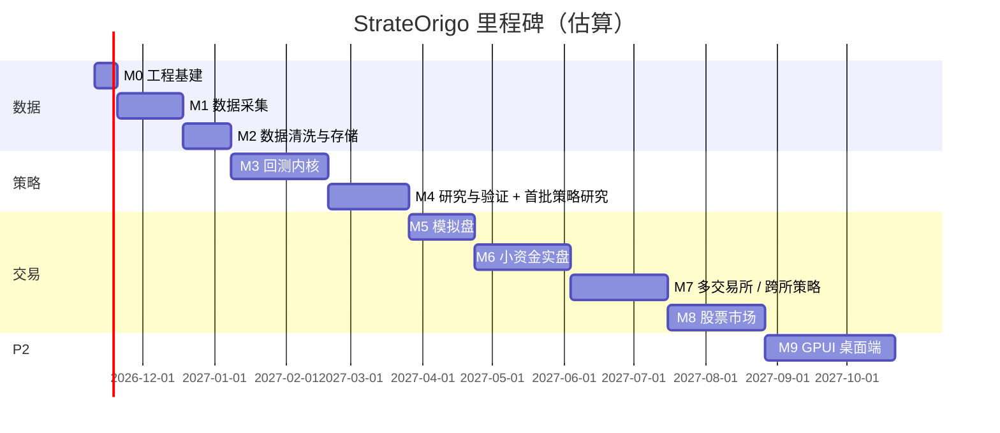

# 05 · 路线图与验收标准

> 原则：**每个里程碑结束时都有一个能用的东西**，且有可度量的验收标准。没有达到验收标准不进入下一阶段。
> 重心顺序：**数据 → 策略与回测 → 交易执行与风控**。GUI 排在实盘稳定之后。
> 工期按"一人 + Agent"估算，仅供参考。

## M0 · 工程基建（约 1.5 周）

**交付物**
- 安装 rustup（Rust 1.99.1）+ VS Build Tools；`git init`。
- Cargo workspace、`rust-toolchain.toml`、`deny.toml`、`.gitignore`（含 `data/`、密钥）。
- Python 包骨架（`uv` + maturin），`import strateorigo` 可调用 Rust 函数。
- 一键检查脚本：fmt / clippy / nextest / deny / ruff / pyright / pytest。
- `so-core`：`UnixNanos`、`Price`、`Qty`、ID、`Clock` + 性质测试。
- `so-telemetry` 骨架：tracing JSON 输出 + 按天滚动 + 固定字段（03 §18.3）；所有程序从第一天起使用同一套日志初始化。
- `so-cli` 骨架（clap 子命令结构）。

**验收**
- [ ] Windows 上一条命令完成全部检查且通过。
- [ ] 定点运算性质测试通过（加减乘除、取整、溢出返回错误）。

## M1 · 数据采集（约 4 周）

**交付物**
- `docs/venues/okx.md`、`docs/venues/gate.md`（基于当前官方文档：WS/REST 端点、深度增量与校验规则、限频、连接寿命、错误码、签名方式）。
- `so-adapter-okx` 行情解析（先做）：深度增量、BBO、逐笔、标记价/资金费、强平；`MarketDataGateway` trait 与 `VenueCapabilities`。
- `so-adapter-gate` 行情解析（后做，同时检验适配器抽象是否通用）。
- `so-recorder`：双连接冗余、去重、Raw Journal、连接轮换、静默断流检测、定时 REST 快照、小时滚动 + sha256、Telegram 告警。
- `so-cli data download`：OKX / Gate 官方历史数据下载（断点续传 + 校验和）；Tardis 下载器（如购买）。
- VPS 选址测试：候选区域各运行 **1 天**，比较 `ts_recv - ts_exch` 分布（2026-11-10 调整，原 3 天）。
- 同步脚本：Raw Journal 回传本地并校验。

**验收**
- [ ] VPS 上连续录制前 20 个永续品种 **1 天**（2026-11-10 调整，原 7 天）；任一单连接断线时数据零丢失（另一连接补齐）。
- [ ] 所有静默断流、缺口都被检测、记录并告警。
- [ ] 解析基准：单核 ≥ 50 万条深度消息/秒。
- [ ] 输出实测存储量（每品种每天）与延迟分布报告，据此确定 VPS 规格与机房。

## M2 · 数据清洗与存储（约 3 周）

**交付物**
- `so-data::normalize`：Raw → 统一 Parquet 表（06 §4.1），`instrument` 时点元数据。
- `so-book`：L2 订单簿 + 序列号校验 + 快照重建（与实盘共用）。
- `so-data::clean`：清洗规则 C1~C13、`flags` 位图、`quality_intervals`、质量评级。
- 每日质量报告（Markdown）+ Telegram 摘要。
- 数据集清单与哈希；`so-cli data normalize / check / ls`。
- Python：`strateorigo.data.load(dataset_hash)` → Polars LazyFrame；Bar 生成（时间/成交量/成交额 Bar）；as-of join 工具。

**验收**
- [x] 重建订单簿与 REST 快照比对，前 20 档一致率 ≥ 99.9%。（2026-11-11，`bookcheck`：f965aee + ea11fa2 修复真实数据回放发现的语义错误）
- [x] 从 Raw Journal 重新生成 Parquet，结果逐位一致（确定性）。（2026-11-11，两次运行 sha256 一致：75df20a）
- [ ] 每条清洗规则都有构造数据的单元测试（含"真实插针不被删除"测试）。
- [ ] 未来函数检查：篡改 t 之后的数据，t 及之前的派生值不变。
- [ ] 如有 Tardis 数据：与自录数据重叠时段的比对报告。

## M3 · 回测内核（约 6 周）

**交付物**
- `so-model`、`so-strategy`（Strategy trait、Ctx、注册宏）、`so-risk`（L1）、`so-oms`（状态机）、`so-engine`（确定性事件循环）。
- `so-backtest`：多表归并 ReplayFeed、SimClock、SimExchange（延迟、排队、费用、资金费）。
- 策略 S1 `st-mm-basic`；markout 与盈亏分解统计；决策管线组件 trait（Signal / Gate / Sizer / ExecPolicy）与决策日志；`so-signal`、`so-exec` 首批算法。
- 实验库（SQLite + Parquet）+ `so-lab` 只读访问库；`so-cli bt run`、`so-cli exp list/show/compare`；报告为 Markdown + PNG。
- `so-py`：`backtest.run()` 返回 Arrow 结果。

**验收**
- [ ] 确定性：同一回测运行 10 次结果逐位一致（insta 快照）。
- [ ] OMS / 撮合性质测试：仓位守恒、资金守恒、状态迁移合法，各 ≥ 10,000 例。
- [ ] 与 hftbacktest 对照：相同数据与模型设置下成交笔数偏差 < 5%，PnL 偏差可逐项解释。
- [ ] 吞吐 ≥ 2M 事件/秒/核；一个月 BTCUSDT L2 数据回测在 10 分钟内完成。
- [ ] 内核 crate 无 tokio 依赖（`cargo tree` 检查）。

## M4 · 研究与验证 + 首批策略研究（约 5 周）

**交付物**
- `strateorigo.features`：技术指标（SMA/EMA/RSI/MACD/布林/ATR/ADX/VWAP）与量化因子（动量、波动率、均值回归、成交量失衡、OFI、盘口失衡、微价格、资金费率因子、基差）。
- `strateorigo.metrics`：07 §10 全部评估指标（与 Rust 侧逐值对齐）。
- 优化方法：网格、随机、贝叶斯（Optuna TPE）、Walk-Forward 优化、蒙特卡洛。
- 信号评估工具：IC / 衰减曲线 / 分组收益 / 成本后收益（07 §3.1）。
- `strateorigo.optimize`：Optuna（本地 SQLite 存储）+ Walk-Forward 调度，并行调用 Rust 回测。
- `strateorigo.validation`：PBO/CSCV、DSR、SPA、Bootstrap、参数稳定性、成本敏感性。
- 策略注册表与生命周期命令 `so-cli strategy promote`（自动检查门槛）。
- 研究并实现 S2 `st-funding-carry`、S3 `st-obi-maker`，各附策略说明文档。

**验收**
- [ ] 验证函数对照已知数值的测试全部通过。
- [ ] 一条命令跑完：优化 → WF → 验证 → 报告 → 写入实验库 → 给出是否通过门槛。
- [ ] 任意实验可凭实验库记录完全重现。
- [ ] `so-signal` 在线特征与 Python 离线特征在同一数据集上逐值一致（误差 < 1e-9）。
- [ ] 交易判断层（Gate/Sizer）相对"信号直接交易"在样本外有稳定改善，否则移除。
- [ ] S2、S3 至少一个通过验证门槛（不通过也要有完整的放弃记录与原因）。

## M5 · 模拟盘（约 4 周）

**交付物**
- `so-trader` paper 模式：实时行情 + SimExchange；**多个虚拟账户**（`[[accounts]]`，每个账户一个策略，可开多个内核分片）；不加载任何密钥。
- 运行模式与配置校验：`mode` 字段、按模式的配置加载器（04 S8/S9）、所有记录带 `mode` 与实例名。
- 影子盘工具：同一策略的两个实例（如将来的实盘 + 模拟盘，或 v1 / v2 两个虚拟账户）同期结果对比报告。
- L2 组合风控线程；gRPC 控制面：**03 §11 列出的 VPS 交易域接口全部实现**（含 K 线 `Market.GetBars/StreamBars`、指标、图表标记、决策日志），每个 RPC 有集成测试，由 `so-cli` 使用验证。M9 的客户端只消费这些接口。
- `so-cli watch`（ratatui 终端实时监控）、`so-cli trader status`。
- 策略实例生命周期（创建 / 启动 / 暂停 / 恢复 / 只减仓 / 退出 / 熔断）与状态恢复；`so-portfolio` 账户内目标仓位缩放、币数上限与 BTC Beta 敞口（03 §14）。
- 实盘输入日志 + `so-cli replay`（03 §17）；定时任务调度（03 §16）。
- 指标与延迟时序落本地文件；Telegram 告警 + 受限命令；每日策略日报。
- 内核 `LogRecord` / `AuditRecord` 队列（03 §18.2）；`so-cli logs`、`Control.SetLogLevel`；日志压缩与清理定时任务。
- 一致性比对工具：模拟盘结果 vs 同期录制数据回放回测。

**验收**
- [ ] 模拟盘连续运行 14 天无崩溃、无内存增长。
- [ ] 模拟盘与回放回测的订单序列一致率 ≥ 99%。
- [ ] 用输入日志重放任意一天的模拟盘，决策与订单序列 100% 一致。
- [ ] 单个策略实例暂停 / 恢复 / 退出不影响其他实例。
- [ ] 一个模拟盘进程同时运行 ≥ 5 个虚拟账户，各账户资金、持仓、盈亏互相独立，结果与逐个单独运行一致。
- [ ] 日志压力测试：运行日志队列被打满时内核不阻塞、延迟不变，丢弃数被正确计数；故障注入测试的全部日志中搜索不到任何密钥。
- [ ] `paper` 配置中出现 `key_file` 或进程尝试读取密钥目录时拒绝启动（测试覆盖）。
- [ ] 内部 tick-to-trade p99 ≤ 50µs（VPS 实测）。

## M6 · 小资金实盘（约 6 周）

**交付物**
- `so-adapter-okx` 交易部分：WS 下单/撤单、私有频道回报、REST 对账、限频管理、Unknown 状态处理；永续 + 现货（S2 需要）。
- **`demo` 模式**：先在 OKX 模拟交易环境跑通完整交易流程（签名、下单、撤单、回报、对账、断线恢复、故障注入），再用真实资金。
- 实盘启动校验：一个交易所一个账户、一个策略（04 S9）；为该策略开设专用子账户与专用 API Key。
- 影子盘：实盘策略同时在模拟盘以相同参数运行，每日输出"真实成交 vs 模拟成交"偏差报告，用于校准撮合模拟器。
- `so-guardian`：心跳、独立账户查询、硬止损、交易所侧 Dead Man's Switch、告警。
- Kill Switch 三通道：`so-cli kill`、Telegram `/halt`、守护进程本地触发文件。
- 部署：systemd unit、启动检查、密钥管理、备份。
- 故障注入测试套件。
- 先上 S2（资金费套利），稳定后再上 S3；每个策略上线前完成人工风险审核（07 §9）。
- 账户与持仓管理完整实现（03 §6.1）：保证金率、强平价、资金费流水、定期对账。

**验收**
- [ ] `demo` 模式连续运行 7 天，订单状态、成交、持仓与交易所模拟环境对账零差异。
- [ ] 包含多个策略或多个账户的 `live` 配置被拒绝启动（测试覆盖）。
- [ ] 故障注入全部通过：断网 / 进程被杀 / 限频 / 回报丢失 / 时钟跳变下无未知敞口，守护进程 ≤3s 内撤单。
- [ ] 主网用**可承受全部损失**的小资金运行 30 天。
- [ ] 实盘 vs 同期回放回测的偏差报告每日自动生成。
- [ ] 本地仓位与交易所仓位对账零差异（或差异全部可解释并自动修复）。

## M7 · 多交易所 / 跨所策略（约 6 周）

- `so-adapter-gate` 交易部分，按 M6 同样的验收标准（先在 Gate 测试网 `demo` 模式验证）；OKX ↔ Gate 跨所资金与风控。
- 跨所策略实例：每个交易所各一个账户 + 一个策略；第二个实盘策略 = 新子账户 + 新实例；`so-guardian` 汇总所有实盘账户的总敞口；子账户资金划转（人工确认）。
- S4 `st-leadlag`、S5 `st-stat-arb` 研究与上线流程。

## M8 · 股票市场（约 6 周）

- IBKR 适配器（美股中低频）；A 股 miniQMT 桥接进程（Windows）与程序化报备流程文档。
- 股票数据：Bar、复权因子、交易日历；T+1、涨跌停、最小申报单位纳入 SimExchange 与风控。
- S6 股票低频策略。

## M9 · GPUI 桌面端（P2，约 8 周）

- 前提：M6 实盘稳定运行 ≥ 3 个月。
- 技术选型见 02 §3（届时重新核对 gpui-component 最新版本）。
- 功能先与 `so-cli watch` 对齐，再扩展盘口、K 线、订单成交表、实验浏览。

## 后续（未排期）

- ML 模型 ONNX 导出与 Rust 推理（MF 策略）。
- ClickHouse 大规模 tick 查询。
- 内置 AI 研究助手。
