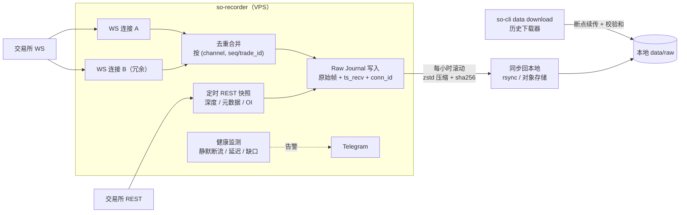

# 06 · 数据获取与清洗

> 数据质量决定策略的上限。本系统的数据层遵循四条原则：
> 1. **原始数据不可变**：采集到的原始帧原样保存，任何清洗都不覆盖原始数据。
> 2. **可重建**：所有规范化和清洗结果都能从原始数据 + 规则版本重新生成。
> 3. **可追溯**：每个数据集有确定的哈希，每次实验引用它。
> 4. **质量可度量**：每个品种每天都有质量评级，回测默认拒绝使用不合格数据。

## 1. 数据需求矩阵

| 数据类型 | HF 做市/微观结构 | 跨所价差 | 资金费率套利 | MF/LF 统计/趋势 | 股票 LF |
|---|---|---|---|---|---|
| L2 深度增量 + 快照 | ●必需 | ●必需 | ○ | ○ | — |
| BBO（最优买卖价） | ●必需 | ●必需 | ●必需 | ○ | ○ |
| 逐笔成交 | ●必需 | ●必需 | ○ | ●（生成 Bar） | — |
| 标记价格 / 指数价格 | ● | ● | ●必需 | ○ | — |
| 资金费率（历史 + 预测） | ○ | ○ | ●必需 | ○ | — |
| 持仓量 OI、强平订单 | ○ | — | ○ | ●（特征） | — |
| K 线 Bar | — | — | ○ | ●必需 | ●必需 |
| 品种元数据（tick/lot/精度/上下架） | ●必需 | ●必需 | ●必需 | ●必需 | ●必需 |
| 手续费等级 | ●必需 | ●必需 | ●必需 | ● | ● |
| 公司行为（拆股/分红） | — | — | — | — | ●必需 |
| 交易日历 / 维护窗口 | ● | ● | ● | ● | ●必需 |

●必需 ○可选 —不需要

## 2. 数据源

| 来源 | 内容 | 粒度 | 历史深度 | 成本 | 用途 |
|---|---|---|---|---|---|
| **自录：OKX / Gate WebSocket** | 深度增量、BBO、逐笔、标记价、资金费、强平 | 逐条 | 从开始录制起 | VPS + 存储 | **主数据源**；HF 回测与实盘一致性的唯一可靠来源 |
| 自录：交易所 REST 定时拉取 | 品种元数据、OI、资金费历史、费率等级、深度快照 | 分钟 / 小时 | 同上 | 免费 | 元数据与辅助特征 |
| OKX 官方历史数据下载 | 逐笔、K 线、资金费等（具体以官网实际提供为准） | 逐笔 / Bar | 视交易所 | 免费 | MF/LF 历史研究；逐笔回测 |
| Gate 官方历史数据下载 | 逐笔、K 线、盘口快照等（具体以官网实际提供为准） | 逐笔 / Bar | 视交易所 | 免费 | MF/LF |
| Tardis.dev | 多交易所历史 L2 增量、逐笔、资金费等 | 逐条 | 多年 | 付费 | 录制开始前的 HF 历史回测；与自录数据交叉验证 |
| OKX / Gate 官方 REST 历史接口 | 近期成交、K 线、资金费历史 | 逐笔 / Bar | 有限 | 免费 | 补数据 |
| IBKR 历史数据 API | 美股 Bar | 分钟 / 日 | 有限，受请求频率限制 | 需行情订阅 | 美股 LF |
| Databento / Polygon | 美股 L1/L2、Bar、公司行为 | 逐条 / Bar | 多年 | 付费 | 美股研究（按需） |
| QMT 内置数据 / Tushare | A 股 Bar、复权因子、财务 | 分钟 / 日 | 多年 | 券商账户 / 积分 | A 股 LF |

**注意**：第三方数据有使用许可（通常禁止转售/再分发），只用于自用研究。

## 3. 采集

### 3.1 采集架构



### 3.2 采集规则

| # | 规则 | 说明 |
|---|---|---|
| A1 | **先存原始帧，再解析** | 解析器有 bug 时仍可从原始数据重建 |
| A2 | `ts_recv` 在收到帧的第一时间打上 | 用 `quanta` 高精度时钟，并换算为 UTC 纳秒；记录本机 chrony 偏差 |
| A3 | 双连接冗余（A/B 流） | 同一频道两条连接，合并去重；任一断线不丢数据。两条连接的到达时间差也是有用的延迟统计 |
| A4 | 主动轮换连接 | 交易所会定期强制断开长连接（如 24 小时）；在到期前主动建立新连接并平滑切换 |
| A5 | 静默断流检测 | 每个频道设"最大无消息间隔"（按品种活跃度设定），超时视为断流，重连并标记缺口 |
| A6 | 深度簿定期 REST 快照 | 除了启动时，每 N 分钟拉一次快照写入 Journal，供清洗阶段校验重建结果 |
| A7 | 订阅数量与限频 | 遵守单连接订阅上限、连接数上限、REST 权重；接入前写入 `docs/venues/<venue>.md` |
| A8 | 录制与交易隔离 | `so-recorder` 与 `so-trader` 是不同进程，可绑在不同核；磁盘写满时录制降级，交易不受影响 |
| A9 | 磁盘与保留 | VPS 只保留最近 N 天原始数据，同步成功并校验 sha256 后才删除 |
| A10 | 历史下载 | 下载器支持断点续传、并发限制、官方校验和（如有）验证，并记录来源 URL 和下载时间 |

### 3.3 采集范围（首期）

- 交易所：OKX 永续 SWAP + 现货（M1 前半），Gate USDT 永续 + 现货（M1 后半）。两所同时录制，为跨所研究积累数据。
- **可选**：只录制、不交易的参考行情（如 Binance 的 BBO/逐笔），作为领先-滞后研究的信号源；不需要账户。
- 品种：按 24h 成交额前 N（初定 20）的永续合约 + 对应现货；品种列表写在 `configs/recording.toml`，变更有记录。
- 频道：深度增量（交易所支持的最快频率）、BBO、逐笔、标记价/资金费、强平；REST：深度快照、元数据、OI、资金费历史。
- 存储量**需在 M1 第一周实测**，再据此确定 VPS 磁盘与同步策略。

## 4. 规范化

规范化 = 把各交易所的原始消息转换为统一事件格式，并定点化。规则版本号为 `normalize_version`。

### 4.1 统一数据表（Parquet schema）

所有时间为 UTC 纳秒 `i64`；价格/数量为定点 `i64`，精度存在文件元数据 `price_scale`、`qty_scale` 中。

| 表 | 主要列 |
|---|---|
| `book_delta` | `ts_exch, ts_recv, seq_first, seq_last, seq_prev, side, price, qty, is_snapshot, conn_id` |
| `book_snapshot` | `ts_exch, ts_recv, seq, side, level, price, qty, source(ws/rest)` |
| `bbo` | `ts_exch, ts_recv, seq, bid_px, bid_qty, ask_px, ask_qty` |
| `trade` | `ts_exch, ts_recv, trade_id, price, qty, aggressor_side` |
| `mark_price` | `ts_exch, ts_recv, mark_px, index_px, est_settle_px` |
| `funding` | `ts_exch, funding_ts, rate_e8, predicted_rate_e8` |
| `liquidation` | `ts_exch, ts_recv, side, price, qty` |
| `open_interest` | `ts_exch, oi_qty, oi_notional` |
| `bar` | `ts_open, ts_close, open, high, low, close, volume, notional, trades, vwap` |
| `instrument`（时点表） | `valid_from, valid_to, venue, symbol, inst_type, tick_size, lot_size, min_notional, price_scale, qty_scale, status, contract_size` |
| `corp_action`（股票） | `ex_date, symbol, type(split/dividend), ratio, cash` |

### 4.2 规范化要点
- **品种元数据按时点（point-in-time）管理**：tick size、精度、上下架都会变；回测在任意时刻都用当时的元数据。
- **保留已下架品种**：避免幸存者偏差。
- 交易所的 symbol 映射到内部 `(venue, symbol)`；同一资产在不同交易所的对应关系单独维护（跨所策略用）。
- 合约到期/换月（交割合约）、币种更名、合约乘数变化都要在 `instrument` 时点表中体现。

## 5. 清洗

### 5.1 原则
- **清洗只加标记，不删原始数据**。清洗输出 = 规范化数据 + 标记列（`flags` 位图）+ 质量区间表 `quality_intervals`。
- 只有"确定是错误"的数据才会在派生数据集中被剔除；**真实的极端行情（闪崩、插针）不删除**，只标记，否则回测会低估尾部风险。
- 清洗规则版本号 `clean_version`，计入数据集哈希。

### 5.2 清洗规则

| # | 问题 | 检测方法 | 处理 |
|---|---|---|---|
| C1 | 重复消息 | 相同 `trade_id`、相同 `seq` | 去重（A/B 流合并时必然出现） |
| C2 | 序列号缺口 | `seq_prev != 上一条 seq_last` 等交易所规则 | 标记缺口区间；该区间订单簿无效，直到下一次快照重建 |
| C3 | 时间戳乱序 | `ts_exch` 非单调 | 保留接收顺序，标记；统计乱序率 |
| C4 | 交叉盘口 | `best_bid >= best_ask` | 标记；持续 > N ms 的区间标记为订单簿无效 |
| C5 | 价格异常跳变 | 相对滚动中位价偏离 > k 倍滚动波动，且短时间内回归 | **只标记**（可能是真实插针）；同时与其他交易所同品种价格交叉比对 |
| C6 | 非法值 | 价格 ≤ 0、数量 < 0、精度不符 | 剔除并计数 |
| C7 | 时钟问题 | `ts_recv - ts_exch` 为负或异常大 | 标记；统计延迟分布；偏差过大的时段降低质量评级 |
| C8 | 断流 | 频道无消息超过阈值 | 标记 stale 区间 |
| C9 | 订单簿重建偏差 | 用 REST 快照校验重建簿的前 N 档 | 不一致率超阈值 ⇒ 标记区间并降低评级 |
| C10 | 交易所维护 / 暂停交易 | 公告 + 品种状态 | 标记维护区间 |
| C11 | 品种元数据变更 | 时点表 | 变更时刻前后分别用各自精度 |
| C12 | 股票公司行为 | 拆股、分红 | 原始价格不改；另存复权因子，研究时按需前/后复权 |
| C13 | 成交与盘口不一致 | 成交价在当时盘口之外 | 标记（可能是时间戳顺序问题或大单扫穿） |

### 5.3 质量评级

每个 `(venue, symbol, channel, 日期)` 生成一行质量记录：覆盖率、缺口数与总时长、乱序率、异常标记数、重建一致率、延迟分位数。

| 评级 | 条件（初始值） | 用途 |
|---|---|---|
| A | 覆盖率 ≥ 99.99%，重建一致率 ≥ 99.9%，无未恢复缺口 | 可用于 HF 回测与晋级 |
| B | 覆盖率 ≥ 99.9%，缺口已全部标记 | 可用于 MF/LF；HF 回测时自动跳过缺口区间 |
| C | 其他 | 默认禁止用于回测，需显式 `--allow-grade C` |

每日生成质量报告 `data/quality/YYYY-MM-DD.md`，汇总异常并通过 Telegram 推送摘要。

## 6. 存储布局

```text
data/
├─ raw/{venue}/{YYYY-MM-DD}/{HH}.{conn}.journal.zst   # 原始帧（不可变）+ .sha256
├─ vendor/{tardis|okx-hist|gate-hist|...}/...          # 第三方原始文件（不可变）+ 来源记录
├─ parquet/{normalize_version}/{venue}/{table}/{symbol}/{YYYY-MM-DD}.parquet
├─ clean/{clean_version}/{venue}/{table}/{symbol}/{YYYY-MM-DD}.parquet   # 含 flags 列
├─ quality/{clean_version}/quality.parquet + YYYY-MM-DD.md
├─ meta/instruments.parquet                             # 时点元数据
├─ datasets/{dataset_hash}.toml                         # 数据集清单（不可变）
└─ experiments.db + experiments/{run_id}/
```

- Parquet：zstd 压缩；按 `ts_recv` 排序；行组大小按"一次回测流式读取"调优（实测确定）。
- `normalize_version` / `clean_version` 升级后**并存**，旧实验仍能引用旧版本复现。

## 7. 数据集与版本

数据集清单示例（`data/datasets/<hash>.toml`）：

```toml
name = "okx-swap-btc-eth-2026q3-l2"
normalize_version = "n3"
clean_version = "c2"
min_grade = "A"
venues = ["okx-swap"]
symbols = ["BTC-USDT-SWAP", "ETH-USDT-SWAP"]
tables = ["book_delta", "book_snapshot", "trade", "mark_price", "funding"]
start = "2026-07-01T00:00:00Z"
end = "2026-10-01T00:00:00Z"
# 下列由工具自动生成
files_digest = "sha256:..."
excluded_intervals = 42
```

哈希 = 所有字段 + 所包含文件内容摘要。回测与实验只能引用数据集哈希，不能引用"某个目录"。

## 8. 数据访问

- **Rust 回测读取**：按块流式读取多个表，按 `(ts_recv, 表优先级, 序号)` 多路归并为单一事件流，内存占用与时间跨度无关。
- **Python 研究读取**：`strateorigo.data.load(dataset_hash)` 返回 Polars LazyFrame；默认附带 `flags`，并提供 `.exclude_flagged()`。
- **派生数据**：由逐笔生成时间 Bar、成交量 Bar、成交额 Bar、tick 失衡 Bar；生成结果也是带版本的数据集。
- **对齐工具**：多品种 / 多交易所按时间 as-of join（只用"当时已知"的数据，防止未来函数）。

## 9. 数据层验收与注意事项

- M1 / M2 验收标准见 [05-roadmap.md](05-roadmap.md)。
- 自录数据与 Tardis 数据在重叠时段互相比对（成交笔数、重建盘口），差异写入报告，用于发现录制或规范化问题。
- 清洗、规范化代码的修改必须附带"新旧版本输出差异报告"。
- **未来函数是最常见的回测错误**：任何特征计算只能使用 `ts_recv`（经延迟模型）之前的数据；测试中加入"篡改 t 时刻之后的数据，t 时刻及之前的特征值必须不变"的检查。

### 9.1 数据层实现约定

数据层（`so-journal` / `so-recorder` / `so-data`）是冷路径，但**同样受全部编码规则约束**（[04 §3](04-dev-constraints.md)）：

| 事项 | 约定 | 规则 |
|---|---|---|
| 模块分工 | 一个功能拆成 `<name>.rs`（纯计算：解析、归一化、校验，可单测）+ `pipeline.rs`（编排）+ `<name>_in.rs` / `<name>_out.rs`（I/O 与序列化） | I8、I9 |
| 参数与回报 | 多次传入的参数收进 `<name>Request`，统计用 `<name>Stats` 返回，不用长参数列表 | I3 |
| 计数而非静默 | 任何被跳过、丢弃、回退的数据都必须进 `Stats` 字段，并出现在日志与质量报告里 | §3.1 |
| 原始数据 | 读取只读不改：尾帧截断、JSON 残缺、精度缺失一律"尽力恢复 + 计数"，**不修改也不重写原始文件** | §3、§5.1 |
| 精度来源 | 唯一来源是当日 `rest.contracts` 快照（时点表）；缺失时回退默认值并**记 WARN 带 `code`** | §4.2、L4 |
| 确定性 | 文件遍历顺序、行排序、去重顺序都显式固定；验收测试是"两次运行逐位一致" | D1、D3 |
| 错误 | 只返回 `DataError` / `RecorderError` / `JournalError`；上下文用命名字段，不拼字符串；库代码不出现 `unwrap()` | E1–E7、E9 |
| 格式归属 | Journal 的**文件格式与读写**只在 `so-journal`（层2）：读端与写端共用同一份换算与帧定义，不各自实现 | A1、I13、[ADR-0016](decisions/ADR-0016-journal-crate-extraction.md) |
| 日志字段 | 与 03 §18.3、04 §3.6 L5 一致：`venue`、`symbol`、`channel`、`date`、`rows`、`files`、`code` | L5 |
