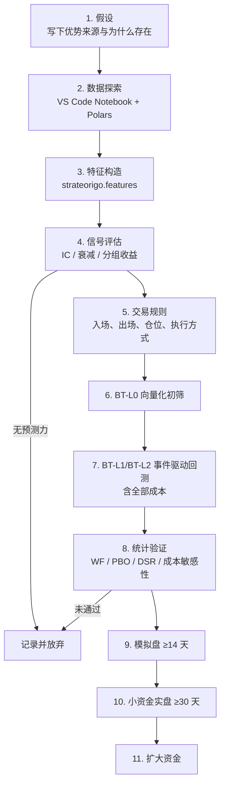
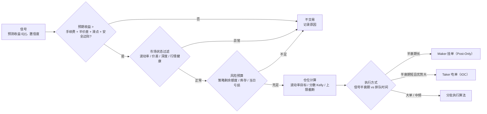

# 07 · 交易策略

> 原则：**先找到来源可解释的优势（edge），再考虑速度；成本优先于信号；简单优先于复杂。**
> 一个策略能否上线，取决于它在扣除全部成本、经过统计验证、在模拟盘与回测一致之后是否仍然盈利，而不是回测曲线好不好看。

## 1. 优势来源分类

| 类别 | 优势来源 | 频率 | 关键数据 | 主要风险 | 难度 |
|---|---|---|---|---|---|
| **做市** | 赚取买卖价差 + Maker 返佣 | HF | `BK-L2`、逐笔 | 逆向选择（被知情交易者吃单）、库存风险、极端行情 | 高 |
| **微观结构预测** | 盘口失衡、微价格、成交流方向对短期价格的预测力 | HF | `BK-L2`、逐笔 | 信号衰减快、对延迟和成本极敏感 | 高 |
| **跨所领先-滞后** | 主交易所价格变化先于其他交易所 | HF | 多所 BBO、逐笔 | 延迟竞争、跨所资金占用、单边成交 | 高 |
| **资金费率 / 期现基差套利** | 永续资金费、期现价差的均值回归 | MF/LF | 资金费、标记价、现货 BBO | 极端行情下的保证金、强平、交易所风险 | 低~中 |
| **统计套利** | 相关币种价差的均值回归（协整） | MF | 逐笔 / Bar | 关系断裂、拥挤 | 中 |
| **趋势 / 动量** | 价格趋势延续 | LF | Bar | 震荡市回撤、容量 | 低 |
| **事件驱动** | 强平连锁、资金费结算前后、上新/下架 | MF | 强平、OI、资金费 | 样本少、易过拟合 | 中 |
| **股票中低频** | 动量、反转、因子 | LF | Bar、复权、财务 | 规则约束（T+1 等）、容量 | 中 |

## 2. 首批策略路线

| 顺序 | 策略 | 类别 | 目的 | 依赖里程碑 |
|---|---|---|---|---|
| S1 | `st-mm-basic`：对称做市 + 库存偏移 | 做市 | **回测内核的验收样例**；建立 markout、逆向选择等度量体系 | M3 回测内核 |
| S2 | `st-funding-carry`：现货多 + 永续空，资金费收益 | 资金费套利 | **首个实盘策略**：频率低、对延迟不敏感，用来验证下单、对账、风控、多账户资金管理全链路 | M4 研究，M6 实盘 |
| S3 | `st-obi-maker`：盘口失衡 / 微价格信号 + Maker 挂单执行 | 微观结构 | 首个真正的高频 alpha 策略 | M4 研究，M6 实盘 |
| S4 | `st-leadlag`：OKX ↔ Gate 领先-滞后（可加 Binance 只读参考行情） | 跨所 | 利用多所数据 | M7 |
| S5 | `st-stat-arb`：币种对协整价差 | 统计套利 | 中频组合 | M7 |
| S6 | 股票低频动量 / 反转 | 股票 | 接入股票市场 | M8 |

> 为什么首个实盘不是高频策略：高频策略的问题往往出在执行和对账细节上，盈亏又对这些细节极敏感，很难区分"策略不行"和"系统有 bug"。先用低频策略把执行链路跑稳，再上高频。

## 3. 研究流程



每一步都在实验库中留下记录；被放弃的想法同样记录（避免重复研究，也用于计算多重检验校正时的试验次数）。

### 3.1 信号评估指标（第 4 步）
| 指标 | 说明 |
|---|---|
| IC / Rank IC（按预测周期） | 信号与未来收益的相关性，例如 100ms、1s、10s、1min |
| 信号衰减曲线 | IC 随预测周期的变化，决定持仓周期与所需延迟 |
| 分组收益 | 按信号分位数分组的未来收益，检查单调性 |
| 换手率 | 决定成本占比 |
| 成本后收益 | 用当前费率与半个价差扣除后是否仍为正 |
| 稳定性 | 按月 / 按波动率区间 / 按品种的分组 IC |

## 4. 交易判断：是否交易、交易多少、怎么交易

信号只是"预测"，交易判断决定这个预测是否值得下单。对应决策管线 Signal → Gate → Sizer → ExecPolicy（见 03 §4.1）。



### 4.1 判断规则
| 环节 | 规则 | 说明 |
|---|---|---|
| 成本门槛 | `E[r] > fee + half_spread + slippage + margin` | `margin` 为安全边际，防止对成本的低估；Maker 用 Maker 费率，Taker 用 Taker 费率 |
| 置信度 | 信号绝对值低于阈值时不交易 | 阈值由样本外数据确定，纳入过拟合检测 |
| 市场状态 | 价差异常扩大、深度骤降、波动率超出训练区间、行情 Gap / Stale 时不开新仓 | 模型在没见过的市场状态下不可信 |
| 时间过滤 | 资金费结算前后、交易所维护前、重大事件窗口 | 按策略配置 |
| 风险预算 | 策略剩余亏损额度、库存软上限、同向敞口 | 超出只允许减仓 |
| 仓位 | 波动率目标（目标波动 / 当前波动）或分数 Kelly（≤ 0.25 Kelly），再按上限截断 | 不使用满 Kelly |
| 执行方式 | 信号半衰期 > 预计排队成交时间 ⇒ 挂单；否则只有在优势覆盖 Taker 成本时才吃单 | 半衰期来自信号衰减曲线 |
| 出场 | 信号反转、达到目标、持仓时间上限、止损 | 每一种出场都有记录 |

### 4.2 交易判断本身也要验证
- 阈值、过滤条件、仓位参数都是参数，**和信号参数一起计入试验次数**，参与 Walk-Forward、PBO、DSR。
- 对比"有判断 vs 无判断（信号直接交易）"的样本外结果，判断层必须带来稳定改善，否则删掉（简单优先）。
- 决策日志中"不交易"的样本同样用于分析：被过滤掉的机会事后收益如何（检查过滤是否过严）。

### 4.3 可复用算法库
| 位置 | 算法 |
|---|---|
| `so-signal` | **技术指标**：SMA、EMA、RSI、MACD、布林带、ATR、ADX、VWAP<br/>**量化因子**：动量、波动率（已实现/EWMA）、均值回归（Z 分数）、成交量失衡、订单流失衡（OFI）、盘口失衡、微价格、资金费率因子、基差<br/>指标与因子是独立模块，不与具体策略绑定；Rust 在线版与 Python 离线版逐值对齐 |
| `so-exec` | Maker 挂单管理（改单阈值、排队位置估计）、IOC 吃单、TWAP、冰山单、跨所对冲腿（一条腿成交后对冲另一条） |
| Sizer | 固定名义、波动率目标、分数 Kelly、库存偏移 |
| 做市报价 | 对称报价 + 库存偏移、Avellaneda–Stoikov 类模型（参数需实证校准） |

## 5. 成本与执行

### 5.1 必须建模的成本
- 手续费：Maker / Taker 费率，按实际 VIP 等级；返佣。
- 价差与滑点：吃单按回测时刻的可见盘口逐档成交。
- 资金费：永续持仓跨越结算时刻时按实际费率结算。
- 延迟：行情延迟 + 下单延迟（经验分布）。
- 借贷利息（现货杠杆 / 卖空）。
- 跨所转账成本与时间（跨所策略的资金再平衡）。

### 5.2 Markout 分析（做市/高频必备）
对每笔成交计算成交后 +100ms、+1s、+10s、+60s 的中间价变化（站在自己这一方）。
- Markout 持续为负 ⇒ 被逆向选择，价差收入被抵消。
- 回测与实盘的 markout 曲线应一致；不一致说明排队模型或延迟模型有偏差。

### 5.3 执行规则
- 挂单优先用 **Post-Only**（GTX），避免意外变成 Taker。
- 报价更新设阈值（价格变化 ≥ N tick 或信号变化 ≥ X 才改单），控制撤单率与限频消耗。
- 库存控制：按库存偏移报价（库存越多，越积极地卖出）；超过库存上限只挂减仓方向。
- 交易所的订单数 / 成交比（order-to-trade ratio）限制纳入 L1 风控。

### 5.4 盈亏分解
实盘与回测都输出同一套盈亏分解：**价差收益 + 库存盈亏 + 手续费/返佣 + 资金费 + 滑点**。策略表现变化时，先看是哪一项变了。

## 6. 策略配置与风控参数

每个策略实例配置（`configs/strategies/<instance>.toml`）必须声明：

```toml
strategy = "st-obi-maker"
version = "0.2.0"
instance = "obi-btc-01"
venue = "okx-swap"

[symbols]
trade     = ["BTC-USDT-SWAP"]                  # 允许下单的品种
watch     = ["ETH-USDT-SWAP", "BTC-USDT"]      # 只看不交易（参考信号、领先指标）
universe  = ""                                 # 可选：选币型策略的币种池，如 "okx-swap-top20"；与 trade 二选一
max_symbols = 1                                # 同时持仓的品种数上限
direction = "both"                             # "both" | "long_only" | "short_only"

[params]
# 默认参数（强类型校验），用相对单位：波动率倍数、bps、盘口档位，而不是绝对价格
spread_vol_mult = 0.8

[params.override."BTC-USDT-SWAP"]
# 某币种的单独参数，必须由该币种自己的验证结果支持
spread_vol_mult = 0.6

[limits]            # 策略级限额，不得超过 configs/risk/ 中的账户级限额
max_position_notional = 2000.0
max_order_notional = 200.0
max_open_orders = 10
max_daily_loss = 50.0
max_drawdown = 100.0
inventory_soft_limit = 0.5   # 占最大仓位比例，超过后只做减仓方向

[kill]              # 自动停止条件
max_consecutive_losses = 20
max_markout_1s_bps = -3.0    # 滚动 markout 低于阈值则停
stale_feed_ms = 500
```

配置规则：
- **策略只交易 `trade` 列表（或 `universe`）中的品种**，`watch` 中的品种只用于计算信号；OMS 在事前风控中拒绝其他品种的订单。
- **同一份代码、不同币种用不同参数**：参数用相对单位表达，币种差异通过 `[params.override]` 体现；每个币种的参数都要有该币种自己的验证实验（引用 run_id）。
- **跨币种稳健性检查**：同一组参数在多个币种上都不亏（不要求都最优）是策略逻辑真实有效的重要证据；只在一个币种上有效的策略视为高过拟合风险。
- **方向限制**：现货默认 `long_only`（不能做空）；永续 / 期货可以 `both`。限制在 `RK-L1` 事前风控中执行。
- 跨所策略（如 S4）每条腿写明所属交易所与账户：`[[trade_legs]] venue = "okx-swap" symbol = "..."`；每个交易所对应一个账户（ADR-0001）。

### 6.1 多币种原则

多币种不会自动分散风险，也可能稀释优势：

| 原则 | 说明 |
|---|---|
| 从 1~2 个币开始 | 先在流动性最好的币上验证（BTC、ETH），再扩展 |
| 币数由验证结果决定 | 只加入**单独通过验证**的币种，而不是"越多越分散" |
| 资金按质量分配 | 验证结果更好、流动性更深的币分配更多资金，不平均分配 |
| 设置上限 | `max_symbols` 限制同时持仓数；币越多，监控和执行成本越高 |
| 看整体敞口 | 山寨币与 BTC 高度相关，多个同向仓位等于一个放大的 BTC 仓位；计算账户相对 BTC 的总 Beta 敞口并设上限（03 §14） |
| 市场中性策略获益最大 | 资金费套利、做市、配对交易在多币种上分散效果明显；方向性策略分散效果有限 |
| 选币本身也是过拟合 | 回测后挑"表现最好的币"等于多一次参数搜索，必须计入试验次数（DSR / PBO），并在样本外重新验证 |

## 7. 实盘监控与淘汰

| 监控项 | 频率 | 动作 |
|---|---|---|
| 实盘 vs 同期回放回测的 PnL / 成交率 / markout 偏差 | 每日 | 持续超阈值 ⇒ 降级为 Paper |
| 滚动 Sharpe、回撤 | 每日 | 低于门槛 ⇒ 降资金或淘汰 |
| 盈亏分解各项的变化 | 每日 | 写入日报 |
| 成交率、撤单率、限频使用率 | 实时 | 风控与告警 |
| 交易所费率等级变化 | 每日 | 重新评估成本敏感策略 |

**每日策略日报**（Markdown，Telegram 推送摘要）：各策略 PnL 分解、成交统计、markout、偏差、风控触发记录。

## 8. 策略代码规范

- 一个策略一个 crate（`crates/strategies/st-*`），**只依赖 `so-strategy`**（`so-signal`、`so-exec` 经其重新导出；见 [04 A3](04-dev-constraints.md)）。
- 参数为强类型 `Config` 结构体，带默认值和取值范围校验（[04 I10](04-dev-constraints.md)），不用 `HashMap<String, Value>` 传参。
- 决策管线组件（Signal / Gate / Sizer / ExecPolicy）各自一个文件（F2/F3）；内核内多态用枚举或泛型，不用 `dyn`（I4）。
- 策略内部状态与信号计算属**热路径**，受 H1–H10 约束：不分配、不加锁、不 panic、价格数量用定点、时间只用 `ctx.now()`。
- 错误只返回本域错误枚举（新建域须先在 [04 §3.3](04-dev-constraints.md) 登记码前缀），不 `unwrap()`；策略里的错误一律"降级或拒绝下单"，不得重试阻塞（E5）。
- 必须包含：
  - 用人工构造事件序列的单元测试（例如"盘口失衡超过阈值时挂买单"）；
  - 一个固定数据集上的回测快照测试（结果变化必须解释）；
  - 策略说明文档 `docs/strategies/<name>.md`。
- 版本号遵循 semver：改变交易行为的修改升 minor 及以上，并重新走验证流程。

### 策略说明文档模板（`docs/strategies/<name>.md`）
```markdown
# <策略名>
## 假设与优势来源
## 所需数据
## 信号与交易规则
## 参数及取值范围
## 成本敏感性
## 已知风险与失效场景
## 验证结果（引用实验 run_id）
## 版本历史
```

## 9. 人工风险审核（进入实盘前必须）

自动门槛（03 §9.3）通过后，进入 `RiskReview` 状态，由人逐项确认并签字，记录写入策略注册表（审核人、时间、版本指纹、结论）：

- [ ] 优势来源能用一句话解释，且不依赖数据错误或回测漏洞。
- [ ] 验证报告：WF 样本外、PBO、DSR、成本敏感性、参数稳定性全部达标；试验次数如实计入。
- [ ] 模拟盘与回放回测的偏差在阈值内；markout 曲线一致。
- [ ] 最坏情况分析：历史最大回撤 × 2、极端行情（插针、断线、交易所宕机）下的最大损失可承受。
- [ ] 策略级限额与账户级限额已配置，且策略级 ≤ 分配的风险预算。
- [ ] 自动停止条件（`[kill]`）已配置并在模拟盘中被触发测试过。
- [ ] Exit 平仓流程在模拟盘中演练过。
- [ ] 与已上线策略的相关性已评估，组合总敞口在上限内。
- [ ] 策略说明文档完整，版本号与代码一致。

**参数优化结果永远不会自动进入实盘**：优化只产生候选，候选必须重新走验证 → 模拟盘 → 审核。

## 10. 评估指标

实验库、回测报告、实盘日报使用同一套指标实现（`strateorigo.metrics` 与 Rust 侧逐值对齐）：

| 类别 | 指标 |
|---|---|
| 收益 | 总收益、CAGR（年化复合收益）、日均收益、单笔期望（Expectancy） |
| 风险调整 | Sharpe、Sortino、Calmar（年化收益 / 最大回撤）、Deflated Sharpe |
| 回撤 | 最大回撤、最长回撤持续时间、回撤恢复时间 |
| 交易质量 | 胜率、盈亏比、盈亏因子（Profit Factor）、平均持仓时间、交易次数 |
| 成本与执行 | 换手率（Turnover）、手续费占比、Maker 成交占比、成交率、markout、滑点 |
| 稳定性 | 按月 / 按市场状态分组的收益、滚动 Sharpe、样本内外差异 |
| 组合 | 策略间收益相关性、各策略对组合收益与回撤的贡献 |
